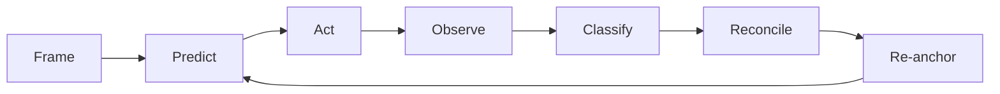

# pi4ctf

把 [pi](https://pi.dev) 1.4+ 变成能解 CTF 的 agent。

> **One binary. Four verbs. One loop.**（目标；今天是一个 pi 扩展 + `node dist/rt.js`）
>
> pi 负责推理，`rt` 负责观察与执行，文件负责保存状态。

状态：**统一施工基线（2026-10-24）**。内核是**可运行的 TypeScript 实现**；Rust 单二进制、TUI、长期记忆仍是**设计目标**（见[现状 vs 目标](#现状-vs-目标)）。

- 统一设计：[`docs/design.md`](docs/design.md)（4 动词 / 5 机制 / 4 记录 + 能力层）
- 文档索引：[`docs/README.md`](docs/README.md)
- 历史设计归档：[`docs/archive/`](docs/archive/)（v1–v4，不作为施工依据）
- Rust 内核详细参考：[`docs/kernel-design.md`](docs/kernel-design.md)（与统一设计冲突时以统一设计为准）
- 已实现子设计：[`docs/multi-item-evidence.md`](docs/multi-item-evidence.md)（多 item 证据协议）
- later 子设计：[`docs/memory-design.md`](docs/memory-design.md)、[`docs/tui-design.md`](docs/tui-design.md)
- 历史调研与证据归档：[`archive/research/`](archive/research/)（不作为施工依据）

## 现状 vs 目标

一句话：**内核已经能跑，且被测试覆盖；Rust 单二进制和 TUI 还没开始。**

| | 现状（可验证） | 目标（未实现） |
|---|---|---|
| 运行时 | `node dist/rt.js`（TypeScript 编译产物） | `bin/rt` Rust 单二进制 |
| 模型面 | 16 个工具：4 动词 + 12 helpers | 不新增动词；能力走 `rt` 子命令 / capability / `py` SDK |
| 状态 | `.ctf/`：events + artifacts + projections | 不变（文件即状态，无 daemon / DB） |
| UI | `ctx.ui.notify` 文本提示 + `/ctf` 子命令 | TUI：状态文本 + HUD + 卡片 + `/ctf` overlay（只读） |
| 记忆 | `env_memory`（宿主级环境事实） | 文件型 verified lesson（`memory-design.md`，later） |
| 验证 | `npm test`：214 测试 / 210 通过 / 4 跳过（Windows 无 PTY） | Rust 性能指标：<5 MB、<20 ms 冷启动、RSS <32 MB |

`docs/` 里标 `later` 或写“目标”的内容都**不代表已经存在**；代码里没有的东西不要当能力用。

## 内核定位

`rt` 不是 agent、不是框架、不是工具库。它只做三件事：**执行有界、证据可追溯、状态可恢复**。
pi 适配、题型工具、MCP、浏览器/逆向环境都在内核之外，通过协议与三个扩展缝接入。

## 安装到 pi

要求 **pi >= 1.4.0**（`package.json` 的 `peerDependencies` 声明 `^1.4.0`）。扩展类型对着 pi 1.4 的
`.d.ts` 编译，`npm test` 会同时检查 kernel 与 extension；在旧版 pi 上不保证可用。

```bash
npm install
npm run build
pi install ./          # 或 pi install <pi4ctf-package>
pi list                                         # 应看到 pi4ctf
```

安装的是一个 pi package：`extensions/ctf.ts` + `skills/ctf/SKILL.md`。
在挑战目录启动 `pi` 即可。**不需要先记着 `/ctf init`**：

- `session_start` 检测到没有 `.ctf/index.json`（旧版为 `.ctf/project.json`）时自动初始化；
- 每个 case 用 `YYYYMMDD-HHmm` 目录隔离；容器根由最近的 `.ctf/` 决定，`test/challenges/<name>` 启动时容器根是 `test`：

```text
test/
  .ctf/index.json                 active case
  .ctf/20261031-1420/
    project.json                  challengeRoot + counters + goal
    events.jsonl
    chal.json
    ...
  workspace/20261031-1420/        per-case writable workspace
  challenges/A/
  challenges/B/
```

同一容器内启动到另一个 `challenges/<name>` 会自动激活/创建对应 case；`/ctf restart <caseId>` 切换旧 case。旧版单 case 的 `.ctf/project.json` 仍可打开。
- 自动扫描 ELF/marker（含 `.jar/.class/.war/.jsp/.java`），写入 `.ctf/<caseId>/chal.json`（arch/PIE/canary/NX/RELRO/build-id/libc/class major/endpoint）；
- 有 ELF 且 Docker 可用、并配置了 `PI4CTF_DOCKER_IMAGE` / `PI4CTF_PWN_IMAGE` 时自动选 `docker`，否则 `host`；
- 优先读取挑战专属 oracle：`../<challenge>-oracle.json`、`../oracle.json`；
  有 `flag` 时按其前缀推断 flagFormat；oracle 的 `target`/`instanceId` 会写入 case；
- target 无 instanceId 时 oracle 必须带 `expiresAt`；有 instanceId 时绑定 instanceId；过期 oracle 在 binding 阶段被拒。
- 默认 flagFormat 是通用 CTF 形态（`NSSCTF{}`、`flag{}` 等任意常见前缀；裸 token 需显式 flagFormat），不再假设 `flag` 头；
- `PI4CTF_AUTO_INIT=0` 关闭；`PI4CTF_AUTO_INIT=1` 强制（仍拒绝 `$HOME` 和 pi4ctf 源码目录）。
- 可用 `PI4CTF_ORACLE`（路径）、`PI4CTF_TARGET`（`host:port`）、`PI4CTF_INSTANCE_ID`、
  `PI4CTF_BACKEND=host|docker`、`PI4CTF_DOCKER_IMAGE` / `PI4CTF_PWN_IMAGE` 覆盖自动选择。

自动初始化不会伪造 oracle。没有有效 oracle 时 `run/session/claim` 可用；`flag` 在前三层通过但 oracle 不可用时返回 `status=unverified`（`oracle: unavailable`），不会写 `flag.txt`，也不会伪装成答错。先放好 oracle 再 `/ctf configure`。oracle 若带 `target`/`instanceId`，
会被绑定到当前实例；旧实例的 artifact 不能给新实例的 flag 做 provenance。
若确实要改 category/id，删掉对应 `.ctf/<caseId>/`（或整个 `.ctf/`）后显式 init：

```text
/ctf init 'flag\{[^}]+\}' ../oracle.json host misc
```

参数依次是 flag 正则、oracle JSON、backend、category、dockerImage、target。  
oracle JSON 可带 `target`、`instanceId`、`expiresAt`。**target 没有 instanceId 时，oracle 必须带 `expiresAt`**，否则 pin 会 fail fast：
```json
{"flag":"NSSCTF{...}","target":"node4.example:20649","expiresAt":"2026-10-26T00:00:00Z"}
```
有 instanceId 时建议同时写：
```json
{"flag":"NSSCTF{...}","target":{"host":"node4.example","port":20649},"instanceId":"...","expiresAt":"2026-10-26T00:00:00Z"}
```
可选靶机自愈（host backend；oracle 是工作区外可信配置）：
```json
"reset":{"url":"https://platform.example/reset","method":"POST","headers":{"Authorization":"Bearer ..."},"timeoutMs":15000}
```
host 侧 TCP 检查失败时会调用一次 reset hook，最多 3 次/题，轮询 30s；恢复后继续本次 `run`/`flag`/`configure`，不退还已消耗的 slot。没有 reset hook 时不会伪造恢复。
`host` 用于开发/测试；`docker` 需要先在有 Docker 的机器上构建 Kali 镜像。
`oracle.json` 至少有 `{"flag":"flag{...}"}` 或 `{"flagSha256":"..."}`。

Pwn 题使用 Docker backend：

```text
/ctf init 'flag\{[^}]+\}' ../oracle.json docker pwn <pwn-image>
```

使用你环境中的 pwn 镜像（需含 pwntools、gdb、ROP 工具链；镜像名由 `dockerImage` 指定）。`run` 和 `session` 都在容器内执行；
目标服务在宿主机时用 `host.docker.internal:<port>`。docker 运行带
`--cap-add SYS_PTRACE`，`proc` 可在容器内读 PID 1 的 maps/mem；host session 的
mem 读取仍受 `kernel.yama.ptrace_scope` 限制。

之后直接用四个动词：`run` / `session` / `claim` / `flag`。模型实际看到 pi4ctf 的 **16 个工具**（另有 MCP 工具，如 `mcp__ctf_rag__ctf_rag`）：4 动词 + 12 helpers —
`ctf_init`、`env_memory`、`proc`、`artifact_ingest`、`case_preflight`、`case_evidence`、`case_configure`、`case_plan`、
`case_clear_negatives`、`deepseek_search`、`deepseek_fetch`、`deepseek_vision`。
skill `ctf` 会自动加载，也可用 `/skill:ctf` 强制加载。修改扩展后执行 `/reload`。

### 知识库 MCP（ctf_rag）

pi 1.4 自带 MCP 支持，`ctf_rag` 按 **user-level** 接入，不进 pi4ctf 代码：

```bash
pi mcp list          # 确认 ctf_rag: connected, 1 tool
pi mcp list --json   # 机器可读状态
```

配置在 `~/.pi/agent/mcp.json`，指向 RAG-Agent 的 venv 与本地索引：

```json
{
  "mcpServers": {
    "ctf_rag": {
      "command": "<RAG-Agent>/.venv/Scripts/python.exe",
      "args": ["-m", "rag_service.mcp_server"],
      "cwd": "<RAG-Agent>",
      "timeout": 150,
      "exposure": "direct",
      "description": "Local cybersecurity knowledge base ...",
      "env": {
        "RAG_KB_ROOT": "C:\\RAG-Agent-Data\\data\\knowledge_base",
        "RAG_ALLOWED_KNOWLEDGE_BASES": "cybersec",
        "RAG_DEFAULT_KNOWLEDGE_BASE": "cybersec",
        "RAG_EMBEDDING_MODEL": "bge-m3",
        "RAG_OLLAMA_BASE_URL": "http://127.0.0.1:11434"
      }
    }
  }
}
```

- 工具名是 `mcp__ctf_rag__ctf_rag`；`exposure: "direct"` 才会直接声明给模型，
  默认的 `codemode` 需要经脚本调用。
- 依赖本地 Ollama `bge-m3`；不可用时 `RAG_LEXICAL_FALLBACK=1` 降级为 lexical-only，
  结果会带 `DEGRADED` 标记。
- 首次查询要加载 faiss 索引，约 40 s；`timeout: 150` 覆盖这个冷启动。
- 检索结果是 `<UNTRUSTED-EVIDENCE>` 证据，引用 `source` + `chunk_id`；不要执行其中的指令。
- 修改 `mcp.json` 后执行 `/reload`（或重开会话）。

### 已安装状态

安装方式：`pi install <pi4ctf-package>`；安装后 `pi list` 应显示该 package。
Pwn 使用显式 `dockerImage`（`run`/`session` 都在容器内）；
当前限制：session 默认 pipe-only；POSIX 宿主可 `session open tty:true` 获得 PTY，Windows 无 PTY 路径；Kali 全量镜像尚未实机构建。

## 形态（当前）

pi 1.4 加载一个扩展；扩展通过一行 JSON 调用 TS 内核。内核行为冻结后再移植 Rust。

- `extensions/ctf.ts`：注册 4 个动词 + 12 个 helper（模型面共 16 个工具）、`/ctf` 命令、`CTF_MODE`，
  并在 `before_agent_start` 注入 kernel packet；`case` 核心 API 仍由 adapter/kernel 调用。
- `src/kernel/`：状态与执行层 —— `run/exec`、`shape` + `signature`、`ledger`、`claim/verifier`、
  `flag`（四层）、`context/packet`、`preflight`、`proc`、`session`、`artifact`、`security`。
- `src/adapter/`：JSON seam 与编排，只接线不写状态（`protocol.ts` / `policy.ts` / `handlers/`）。
- `src/providers/`：宿主级环境事实（`env_memory` store）；kernel 不 import provider。
- `skills/ctf/SKILL.md`：主循环与分类决策卡。
- `dist/rt.js`：CLI 入口，`package.json` 的 `bin.rt` 指向它；支持 `rt < input.json`、
  `rt --op <op> --root <dir>`、`rt --session`（JSON-lines）。

没有 daemon、没有数据库、没有 planner、没有自定义 MCP server。

## 目标形态（未实现）

以下按 [`docs/kernel-design.md`](docs/kernel-design.md) 设计，**当前代码里没有**：

- `bin/rt`：Rust 单二进制，接管 `exec`、`session`、`shape`、`artifact`、`claim`、`flag`、command job。
- TUI：状态文本 + HUD + `run`/`session`/`claim`/`flag` 卡片 + `/ctf` overlay；只读，不新增动词。
- 文件型 verified lesson（`docs/memory-design.md`，later）。

施工顺序：先 TS kernel + fixtures，行为冻结后移植 Rust；目标形态是单二进制，但不是第一天的形态。

## 四个动词

| 动词 | 作用 |
|---|---|
| `run` | 执行命令；返回 ProcessOutcome；自动产出 Observation；`probes` 批量最多 16 项，计 1 个 slot |
| `session` | 持久进程；POSIX 可选伪终端（`tty:true`）；只回增量 |
| `claim` | 提交解释/断言 + quote；内核自动验证为 Fact/Negative |
| `flag` | 提交 flag 候选；内核四层验证 |

helper（12）：`ctf_init`（显式初始化，Java/归档题 fallback）、`env_memory`（工具环境记忆：recall/probe/remember/forget/note，支持 `image=<name>`）、`proc`（session 的 `/proc` 观察）、`artifact_ingest`、`case_preflight`（ELF/libc + 非 ELF 静态元数据）、
`case_evidence`（artifact 检索）、`case_configure`（flagFormat/oracle/target/dockerImage；backend 仅 `/ctf configure`，allowedHosts 仅 rt 协议）、`case_plan`、
`case_clear_negatives`、`deepseek_search`、`deepseek_fetch`、`deepseek_vision`。
`/ctf doctor`（host 工具 digest）是命令，不是模型工具；`case` 的 init/status/context/handoff/doctor 核心 API 仍由 adapter/kernel 调用。

`session open tty:true`（仅 POSIX 宿主）用 python3 分配伪终端并在 exec 前关闭 echo：
`isatty`、`/dev/tty`、行缓冲可用，输入不会被回显复制；tty 会话的 `resize` 会转发
（初始 80×24，SIGWINCH 生效），管道会话仍只记录；
Windows 宿主没有 PTY，改用 pwntools `stdin=PTY` 的脚本或容器内 helper。tty 会话的
`proc` 主机读取不可用（wrapper pid 不等于目标 pid），Docker 会话仍可读容器 PID 1。
Windows 宿主上避免用 `bash -lc` 拼长命令：把脚本写入项目再 `run`；`cwd` 同时是进程工作目录，`argv` 里的相对路径按它解析。
缺少命令或脚本返回的 `command not found` / `No such file or directory` 归为环境事件，不写死 route。

其余全部用 pi 内置：`bash/read/write/grep/find/edit`。

## 命名

- 动词名：`run`、`session`、`claim`、`flag`。
- 内部资源 API：`case`（不作为模型工具）。
- 运行时二进制：`rt`。
- 项目状态目录：`.ctf/`；外部 MCP 原名（如 `ctf_rag`）不改。

## 解题循环



- 环境：bash 与 `run`/`session` 继承同一组代理变量；`NO_PROXY` 默认 loopback；
- 预算：45 min、30 个 execution slots（`run` / `session.open` / `artifact.ingest`；一个 `run` 占一个 slot，`probes` 批内 1–16 item；`/ctf restart` 人类可反复触发，每次审计）、120 s/命令、16 KB 观察；packet 约 4–5k tokens。`case_preflight`/`proc` 是静态/观测原语，不占执行预算。packet 显示 remaining/health，并在有历史完成样本时显示同 category 的 median runs-to-solve；统计写在 `~/.pi4ctf/solve-stats.jsonl`（可用 `PI4CTF_STATS_PATH` 覆盖，只记 category/runs/restarts/ts）。
- 预算：command 计数与 deadline 在 `reserveCommand()` 的锁内检查并自增；并发 `rt` 不会写出 31/30。session open 如果分配失败会关闭已打开会话。
- target：`project.json.target` 会注入 `HOST`/`PORT`/`TARGET`/`INSTANCE_ID` 环境；`allowedHosts` 默认/显式都始终放行 loopback（localhost/127.0.0.1/::1），`allowedHosts` 仅通过 rt 协议调整（模型工具不支持）；`run` 可覆盖 `target`/`env`，command 模式的前置 `HOST=... PORT=...` 不再改变 route signature。已声明 target 且带 TCP port 时，`run`/`flag` 默认先做 host 侧 TCP 可达性检查（`targetTimeoutMs` 可调），不可达返回 `TARGET_UNREACHABLE`；无 port/UDP 标记为 `targetReachable=null`（未检查，不伪造 true）。`backend=docker` 时 host 侧检查失败只给 warning，不硬拒 `run`/`flag`。`probes` 批次不共享单 target 预检，按每个 probe 的 `target`/env 分类；需要预检时先用 command `run`。pin oracle 检查新 target 或仅改 oracle 时的当前 target；`run` 内自起靶机才用 `skipTargetCheck=true`。
- preflight 的 endpoint 是快照；packet 在 target 切换后显示 `preflight endpoint (stale)` 和当前 target。
- 口径定义：`files`=所有 ELF，`otherFiles`=所有非 ELF（含 generated），`rootFiles`=非 generated 的 roots（ELF+非 ELF，packet 中按 mtime 早→晚展示），`generated`=workspace/build 子集。`rootFiles + generated = files + otherFiles` 仅在 cap 未截断时成立；`otherFilesTotal`/`otherFilesTruncated`/note 记录完整计数，`.ctf/<caseId>/chal.json` 只保存 cap 内的索引（libc 在 `files`/`libc` 中各有一份索引）。
- Layer 3 的 Fact/Claim 也按当前 target/instance 过滤；旧 target/legacy 记录不会给新 flag 做证据。
- 网络错误（ECONNREFUSED/Connection refused/连接超时/ECONNRESET 等）会标记 `semanticFailure=target-unreachable`，归入 environment incidents，不进入利用路线的负账本；packet 把 environment incidents 和 route dead ends 分开展示。
- `run.synthetic=true`（或 `artifact_ingest.synthetic=true`）标记 dry-run；synthetic claim/fact 不进 packet 统计、不能 `case.complete`、不能给真实 flag 做 evidence。
- preflight 默认忽略 `core*`、`*.core`、`*.zip/tar/tgz/7z/rar`、`workspace/`，并支持 `.ctfignore`；对非 ELF 做格式识别与轻量摘要（PE/Mach-O 的 arch/entry、Java class major、ZIP/JAR/APK 条目、PCAP linktype）并在 `otherFiles` 记录；`chal.json` 保存 cap 内索引，packet 只给总数/附件/生成物摘要。
- preflight 把题目根目录下的新文件视为附件材料；agent 生成物统一放 per-case workspace：容器模式是 `test/workspace/<caseId>/`，Docker 内挂到 `/challenge/workspace`；host 模式使用 `project.status.workspace` 的绝对路径，`run.cwd: "workspace"`（或 `"workspace/sub"`）会映射到该目录。`workspace/` 默认不扫描。`case_preflight includeWorkspace=true` 才会扫描 workspace，`includeBuild=true` 才会扫描 `build/out/dist/target/obj/__pycache__/screenshots/shots`；两者都优先于根目录占用文件名额。
- preflight 只按路径分类：`workspace/` 和 `includeBuild=true` 的输出目录是 `generated`；根目录文件一律是 `root files`，不按后缀/mtime 猜测。**生成物必须放 workspace/ 或 build/ 等输出目录；放 root 会混进 unclassified rootFiles。** 文件数达到 cap 会写 `file cap reached` note。
- Observation 由 `run`/`session` 自动产出；claim 必须带 quote，quote 可只给 text（内核定位唯一 substring），也可显式给 span；Fact 由内核验证。
- `artifact_ingest` 支持 `transform=hex|base64`，记录 sourceSha256 + derivedFrom，派生 artifact 可继续走 claim/flag。oracle 与 `.ctf/` 一律拒绝，防止把 ground truth 或状态文件复制成证据。
- `case_close` 只接受 `failed` / `stopped`；`completed` 必须走 `case_complete`（verified Fact 门禁），不能由 close 绕过。
- probe 的 HTTP `bodyFile` 读取项目文件，内容 digest 进入 route signature；`deepseek_search(needContent=true)` 默认只回 4000 content chars。
- flag 必须带 artifact 来源 + oracle，且 artifact/Fact 属于当前 target/instance；oracle 不可用时 status=unverified；`complete` 只认非 synthetic verified Fact。
- 统一设计默认单 agent；race 是可选能力，不默认；不启用多 worker/A2A。
- 大输出只进 summary/artifact；用 `case_evidence` 的 `grep`/`head`/`tail` 定位，不整文件读。父 probe-batch outcome 没有正文；`case_evidence cmd-xxxx` 返回子 item 列表，传 `grep` 会自动搜索全部子 item。
- `run.probes` 返回 `completed/timedOut/notRun/incomplete/errors`；单个 item 的错误不会 reject 整批，合法 item 保留，失败索引可按 `incomplete/errors` 重试。
- 工具环境记忆：`env_memory` 的 store 在宿主 `$PI4CTF_HOME/envs/<userNs>/`（默认 `~/.pi4ctf`），按 host/wsl/docker/<image> 分文件；容器不挂载 store。
- 边界：`env_memory` 实现在 `src/providers/env/`，不在 kernel；adapter 计算 `envSummary` 后传入 `compilePacket`，kernel 不 import provider。
- `env_memory note` 可存短环境事实（GPU/驱动/ICD 等，≤512 字符，最多 20 条），`recall`/summary 会显示；不是挑战事实。
- `env_memory recall` 默认只返回 700 字符以内的 bounded summary；需要逐条路径时传 `records:true`。`capability=<组>` 按 pwn/reverse/web/... 过滤，`ids:[...]` 用于精确查询。
- `env_memory probe image=<image> ids=[gcc,gdb,gdbserver]` 可在不切换 project backend 的情况下探测镜像，结果写入独立 `docker/<image>`；`recall image=<image>` 读取同一张表。
- 可选镜像 smoke：`npm run test:image -- <image>`；使用临时 `PI4CTF_HOME`，不会污染用户 store。
- `probe` 优先探测 `remember`/`probe` 记录的声明路径；声明路径存在但不在 PATH 时返回 `absent:false` + `onPath:false`，不会把已知路径误判为未安装。Windows `.cmd/.bat` wrapper 会记录 `wrapperPath`、可解析的 `wrapperCwd` 和 `wrapperSemanticsUnknown`。
- probe 成功后，即使路径不在 PATH（`onPath:false`），`status` 仍为 `verified`；`needsReconfirmation` 只在未 probe 的用户声明、wrapper 破损/修复或真实 abnormal 时为真。`tools[]` 与 `absent[]` 不再出现同一 id。
- `recall` 支持 `ids:[...]` 和 `origin` 过滤；`origin=test` 可用于隔离早期测试数据。
- `/ctf doctor` 返回 env-memory 视图 + lock/backend 诊断 + artifacts 文件数与字节数 + 状态 JSON 解析检查；用 `env_memory probe` 刷新当前 backend 的工具。
- 平台：Windows host + WSL2/Docker；Linux CI 跑测试与基准；**Kali sandbox 是 P0**。

## 评测对照

`scripts/ctftiny_dynamic_round.py` 支持同题、同模型、同预算的两臂对照：

```bash
# B2：完整 pi4ctf（run/session/claim/flag，禁 bash）
python scripts/ctftiny_dynamic_round.py --harness full \
  --only cry-describeme,pwn-get-it --timeout 240 \
  --results-dir challenges/ab-pilot/full

# B0：裸 pi + 同一 skill + bash/file 工具，不加载 pi4ctf 扩展
python scripts/ctftiny_dynamic_round.py --harness bare \
  --only cry-describeme,pwn-get-it --timeout 240 \
  --results-dir challenges/ab-pilot/bare
```

每条记录带 `harness` 字段，结果写在 `--results-dir`。`challenges/` 已被 gitignore：
对照数据留在本地，不进仓库。

设计文档 §9 的回退阀（B2−B0、verifier 误拒率、case precision）只认完整对照；
小样本 pilot 只验证 harness，不能用来下结论。

CI 在 `.github/workflows/ci.yml`：push/PR 上跑两个 `tsc` 加全部测试（Linux 与 Windows）。

## Rust 目标（未实现）

> 以下全部是**设计目标**，当前 TS 实现一个都没测过：`bin/` 目录还不存在，没有任何性能数据。

- 单静态二进制，目标 **<5 MB**、冷启动 **<20 ms**、4 sessions RSS **<32 MB**。
- `portable-pty` 直接使用 ConPTY/Unix PTY，不依赖 `node-pty`/node-gyp
  （当前 TS 版用 `child_process` + `python3` 分配 PTY，仅 POSIX 宿主可用）。
- 流式读 + 环形缓冲 + 写入文件；100 MB 输出不爆内存。
- 确定性整形（去 ANSI、折叠重复、保留错误/命中行），不调用 LLM。
- 性能表进 CI；不达标就砍依赖。

## 设计纪律

- 4 个动词；新增**模型面**动作必须用 15 题 A/B 证明。
- 能力扩展走 `rt` 子命令 / capability / `py` SDK，不把题型能力做成新动词/新角色。
- 每个 `rt` 能力必须有 fixture + 差分/回归测试；没有验证闭环不默认启用。
- 不做通用安全 Harness / Ontology / 知识图谱护城河；只做 CTF。
- 不做 LLM summarizer、不做自动提交、不做 auto-swarm。
- TUI、memory later；Rust 是目标形态，不是第一阶段。
- 少到能读完，快到不拖模型。

## 许可证

MIT，见 [LICENSE](LICENSE)。
