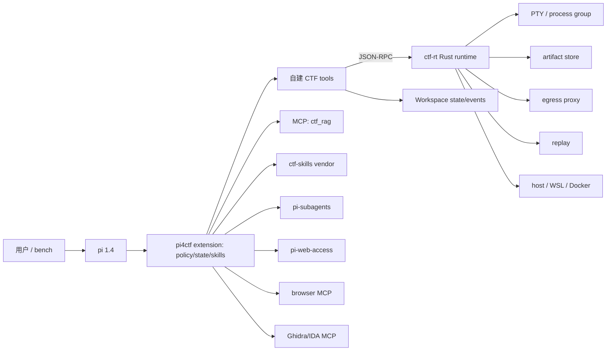

# pi4ctf 施工基准方案 v0.3

> [!IMPORTANT]
> v1 施工以 [`minimal-design.md`](minimal-design.md) 为准（1 个 Rust 二进制、3 个工具、1 个循环）。
> 本文保留为完整能力/运行时研究，不直接约束 v1 的工具数量与常驻架构。

> 目标：把 pi 1.4+ 装备成能实际解 CTF 题的 agent，能力对标 omp 18.4.9。
>
> v0.2 的核心变化：**先查外部项目，再决定造什么**。CTF 知识、子代理、联网、浏览器、逆向 MCP 直接复用；pi4ctf 只新建“题目状态机 + flag 溯源 + 执行后端 + 评测”。
>
> v0.3 的核心变化：**薄策略层 + 硬运行时**。加入 Observation Contract、Provenance Ledger、按需 fresh-context worker，以及 Rust `ctf-rt`（PTY/进程组/输出整形/artifact/egress/replay）。设计依据与消融计划见 [`design-rationale.md`](design-rationale.md)，能力提升与分类决策卡见 [`capability-plan.md`](capability-plan.md)，证据强度与突破赌注见 [`evidence-audit.md`](evidence-audit.md)。

---

## 0. 结论（TL;DR）

| 决策 | 内容 |
|---|---|
| 形态 | 可 `pi install` 的 pi package；pi **1.4.0** |
| 分层 | TS 策略层（pi extension）+ Rust `ctf-rt` 运行时（PTY/进程/整形/artifact/egress/replay） |
| 复用 | 内置 `read/bash/edit/write/grep/find/ls/codemode/MCP`；`pi-subagents`；`pi-web-access`；`ctf-skills`（MIT）；Chrome DevTools/Playwright MCP；Ghidra/IDA MCP |
| 自建 | `ctf_challenge`、`ctf_run`、`ctf_session`、`ctf_py`、`ctf_note`、`ctf_flag`、`ctf_env`、`ctf_writeup`、`ctf_submit` |
| 核心 | 观察契约 + 溯源账本 + 机器 oracle；不是“再写 100 个 CTF 工具” |
| 执行 | host / WSL2 Kali / Docker；pwn/rev 默认 WSL |
| 知识 | `ctf_rag` MCP（101 万 chunk）+ `ctf-skills` 12 个类别 skill |
| 评测 | CTFTiny 50 + NYU 200（可选）；同模型/预算 vs omp；闭卷为主，防题解泄漏 |
| 非目标 | 不做 swarm/全局调度器、不 fork 内核、不自动提交、不重复实现子代理/搜索/浏览器 |

---

## 1. 目标、验收与非目标

### 1.1 必须做到

1. `/ctf` 能把本地题目目录或远程目标变成可解工作区，并恢复上次状态。
2. 单题主循环自主完成：侦察 → 假设 → 执行 → 取证 → 验证 flag → writeup。
3. 六大类可跑：pwn、web、crypto、rev、misc、forensics。
4. 硬约束：命令超时、进程组杀灭、网络白名单、flag 溯源、输出上限。
5. `ctf_rag` 可用且必须引用；`ctf-skills` 按需加载，不一次性塞满上下文。
6. CTFTiny 50 同模型解出率 ≥ omp，误报 flag = 0。
7. 无头模式可批量跑题；交互模式不阻塞。

### 1.2 明确不做

- 不做 planner/blackboard/swarm；多代理是显式选项，不是默认。
- 不 fork pi/omp；不把任何本地旧 CTF 项目当底座。
- 不自动提交 flag；无头模式只写 `flag.txt`。
- 不承诺 host/WSL 强沙箱；严格隔离只走 Docker。
- v1 不做 LSP/DAP、桌面控制、长期 memory。
- 不以 CTFd 为运行前提；只留适配器。

### 1.3 验收

| 维度 | 门槛 |
|---|---|
| 功能 | 每类至少 1 题端到端；工具契约单测全绿 |
| 基准 | CTFTiny 50：解出率 ≥ omp；误报 0；中位耗时 ≤ omp ×1.2 |
| 安全 | 工作区外写入 0；未授权外网 0（严格模式）；flag 误报 0 |
| 可复现 | `state.json + events.jsonl` 能重建解题过程 |

---

## 2. 事实与外部经验

### 2.1 本机事实

| 项 | 事实 |
|---|---|
| pi | 已升级 **1.4.0**；内置 `read/bash/powershell/edit/write/grep/find/ls`，可选 `codemode/tool_search`，MCP 原生 |
| omp | **18.4.9**；31 工具；强项 `task/todo/ask/browser/web_search/lsp/debug/eval` |
| 知识库 | `RAG-Agent/rag_service`，stdio MCP，FAISS + bge-m3，约 101.7 万 chunk |
| 基准集 | `CTFTiny` 50 题（rev 16、crypto 12、pwn 11、misc 6、web 3、forensics 2）；`challenge.json` 内含 flag |
| 本机 | Windows 11；WSL2 Kali/Ubuntu；Docker 29；host Python 3.13；gdb/objdump/checksec 有，pwntools 无 |

### 2.2 外部项目经验（这轮补的功课）

| 项目 | 关键事实 | 对设计的约束 |
|---|---|---|
| [EnIGMA](https://arxiv.org/abs/2409.16165)（ICML 2025） | 给 SWE-agent 加**交互式 gdb/pwntools 会话**和长输出 summarizer；NYU CTF 13.5%（Claude 3.5），比基线 4% 高 3 倍；交互工具让平均少 22.8% turns；消融显示 demos +6.2pp，summarizer 有用 | 必须有**持久交互会话**（我们的 `ctf_py` + `ctf_run`）和**输出截断/落盘**；演示/示例要按类别给 |
| EnIGMA 的 **soliloquizing** | Claude 在 NYU 轨迹中 **48.4%** 出现“自己编造 observation”，不执行就写观察；但真正 flag 泄漏很少 | **不能相信模型转述的执行结果**；一律以工具输出/文件为证据；flag 必须溯源 |
| [D-CIPHER](https://arxiv.org/abs/2502.10931) | Planner + Executor + Auto-prompter；NYU 19.0%（Claude 3.5），无 auto-prompter 22.0%；比 EnIGMA 高约 5.5pp；上下文只保留最近几轮，成本 $0.5 级 | 多代理有收益但非质变，且带来调度/成本/上下文问题；**v1 单 agent，`subagent` 仅显式启用** |
| [NYU CTF Bench](https://github.com/NYU-LLM-CTF/NYU_CTF_Bench) | 200 test + 55 dev；`challenge.json` + Docker compose；`nyuctf` Python 包可加载 | 评测要分 dev/test，避免过拟合；复用 `nyuctf`/CTFTiny，不自己造数据集 |
| [ctf-skills](https://github.com/ljagiello/ctf-skills)（MIT，3.5k★） | 12 个类别 skill：web 23 文件、pwn 65、crypto 19、reverse 22、forensics 14、misc 13、osint、malware、ai-ml；含 `solve-challenge` 路由、`ctf-writeup`、工具安装脚本、Ghidra/IDA/Burp/Playwright MCP 文档 | **直接 vendor**，不重写类别知识；只做 pi 命令名适配和“状态/flag”纪律补充 |
| [pi-subagents](https://github.com/nicobailon/pi-subagents) | 573K 下载/月；单/并行/后台子代理、agents、工具白名单、worktree、typed 结果 | 不自建 `task`；作为 companion 依赖，定义 CTF agents |
| [pi-web-access](https://www.npmjs.com/package/pi-web-access) | 搜索、URL 抓取、PDF、视频；多 provider | 不自建 `web_search`；作为可选 companion |
| [Chrome DevTools MCP](https://github.com/ChromeDevTools/chrome-devtools-mcp) / [Playwright MCP](https://github.com/microsoft/playwright-mcp) | 真实浏览器、DOM/网络/截图/交互 | 不自建 browser；MCP 配置即可 |
| [Ghidra MCP](https://github.com/bethington/ghidra-mcp) / [IDA Pro MCP](https://github.com/mrexodia/ida-pro-mcp) | 无 GUI 反编译、xref、重命名、patch | rev 不自建反编译器接口；可选 MCP |
| [omp](https://github.com/can1357/oh-my-pi) | 31 工具、原生 shell/LSP/DAP/subagents；是能力基线 | 用同一模型/预算对跑，不逐项模仿 |

### 2.3 复用矩阵：只造四件事

| 能力 | 现成方案 | pi4ctf 是否自建 |
|---|---|---|
| shell / 文件 / 搜索 | pi 内置 `bash/read/write/edit/grep/find/ls` | 否 |
| 并行工具调用 | pi `codemode` | 否 |
| 子代理 | `pi-subagents` | 否（只写 CTF agent 定义） |
| 联网搜索/抓取 | `pi-web-access` | 否 |
| 浏览器 | Chrome DevTools/Playwright MCP | 否 |
| 反编译 | Ghidra/IDA MCP | 否 |
| CTF 类别知识 | `ctf-skills` | 否（vendor + 适配） |
| 知识库 | `rag_service` MCP | 否（注册） |
| 基准数据 | CTFTiny / NYU / `nyuctf` | 否（staging + runner） |
| **题目生命周期/状态** | 无 | **是：`ctf_challenge` + `ctf_note`** |
| **执行后端/安全** | 无 | **是：`ctf_run` + `ctf_py` + `ctf_env`** |
| **flag 溯源/oracle** | 无 | **是：`ctf_flag`** |
| **CTF 模式评测** | 无 | **是：bench harness** |

### 2.4 由此导出的五条硬约束

1. **观察必须来自环境**：模型转述不算证据；所有 attempt 绑 `command_id`。
2. **长输出必须截断/落盘**：stdout 64KB 进上下文，完整进 artifact；否则重演 EnIGMA 的上下文爆炸。
3. **交互会话要持久**：pwn 连接、gdb、Python 命名空间不能每条命令重建。
4. **多代理默认关**：先测单 agent 基线；并行只在“多路线独立可证伪”时开。
5. **知识按需加载**：`ctf-skills` 只加载当前类别；RAG 一次查询，不刷屏。

---

## 3. 总体架构



原则：

1. pi 是运行时；所有增强在 package 内，升级 pi 不冲突。
2. 状态在磁盘；上下文可丢，状态不丢。
3. 工具少而硬；类别知识进 skill，执行统一走 `ctf_run`/`ctf_py`。
4. 先证据后结论；flag/漏洞/环境假设都要能指回输出或引用。
5. 默认单线程；并行显式。

---

## 4. 包结构、安装与 companion

```text
pi4ctf/
├─ package.json
├─ extensions/
│  ├─ index.ts                  # 注册工具、命令、MCP、hooks
│  ├─ config.ts
│  ├─ workspace.ts
│  ├─ runtime-client.ts          # JSON-RPC → ctf-rt
│  ├─ py/kernel.py
│  └─ tools/{env,challenge,run,session,py,note,flag,writeup,submit}.ts
├─ runtime/                     # Rust workspace
│  ├─ Cargo.toml
│  └─ src/{main,pty,exec,shape,artifacts,egress,replay,rpc}.rs
├─ bin/<platform>/ctf-rt[.exe]  # 预编译；缺失时降级 TS exec
├─ skills/
│  └─ ctf-mode/SKILL.md         # 本包唯一的“纪律”skill
├─ vendor/ctf-skills/           # 上游 pinned + LICENSE + NOTICE
├─ prompts/ctf.md               # /ctf 入口
├─ agents/                      # pi-subagents 的 CTF agent 定义
├─ scripts/{doctor.py,install-wsl-kali.sh,sync-ctf-skills.sh,build-runtime.mjs}
├─ bench/{stage.py,run.py,report.py}
├─ config/pi4ctf.example.json
└─ docs/
```

`package.json`：

```json
{
  "name": "pi4ctf",
  "version": "0.1.0",
  "keywords": ["pi-package", "ctf"],
  "pi": {
    "extensions": ["./extensions"],
    "skills": ["./skills", "./vendor/ctf-skills"],
    "prompts": ["./prompts"]
  },
  "peerDependencies": {
    "@earendil-works/pi-coding-agent": ">=1.4.0",
    "@earendil-works/pi-tui": "*",
    "@earendil-works/pi-ai": "*",
    "typebox": "*"
  }
}
```

Companion（安装时检查，不静默假设）：

```bash
pi install npm:pi-subagents@0.81.0     # 可选并行；版本 pin
pi install npm:pi-web-access@0.44.0    # 可选联网
pi mcp add playwright -- npx -y @playwright/mcp@0.0.83   # 可选浏览器
```

`ctf_env` 报告 companion 是否存在、版本是否兼容；缺失只降级，不阻塞。

**vendor 策略**：`ctf-skills` 固定 commit `1fdf188cb7ac`（2026-10-20），保留 MIT LICENSE 与 NOTICE；`scripts/sync-ctf-skills.sh <ref>` 用于升级，升级后跑 `scripts/smoke-skills.sh` 校验 SKILL.md 可加载、链接无断链。上游是 Claude Code 命令名（`/ctf-web`），pi 用 `/skill:ctf-web` 或 `read skill://ctf-web`；`ctf-mode` 里给映射表。

---

## 5. 配置

优先级：CLI flag > 环境变量 > 项目 `.pi/pi4ctf.json` > 用户 `~/.pi/agent/pi4ctf.json` > 默认。

```json
{
  "workspaceRoot": "ctf-work",
  "defaultBackend": "host",
  "categoryBackends": {
    "pwn": "wsl", "rev": "wsl", "web": "host",
    "crypto": "host", "misc": "host", "forensics": "host"
  },
  "wsl": { "distro": "kali-linux", "python": "python3" },
  "docker": { "image": "pi4ctf/kali:latest", "network": "none" },
  "timeouts": { "runSec": 120, "pySec": 60, "subagentSec": 900 },
  "limits": { "stdoutKb": 64, "routes": 3, "artifactMb": 200 },
  "network": { "allowedHosts": [], "requireConfirmation": true, "allowExternal": false },
  "rag": {
    "enabled": true, "server": "ctf_rag",
    "command": "C:/Projects/Agent-projects/RAG-Agent/.venv/Scripts/python.exe",
    "args": ["-m", "rag_service.mcp_server"],
    "cwd": "C:/Projects/Agent-projects/RAG-Agent",
    "timeout": 150,
    "env": {
      "RAG_KB_ROOT": "C:/RAG-Agent-Data/data/knowledge_base",
      "RAG_ALLOWED_KNOWLEDGE_BASES": "cybersec",
      "RAG_DEFAULT_KNOWLEDGE_BASE": "cybersec",
      "RAG_EMBEDDING_MODEL": "bge-m3",
      "RAG_OLLAMA_BASE_URL": "http://127.0.0.1:11434"
    }
  },
  "companions": { "subagents": true, "webAccess": false },
  "mcp": { "browser": "playwright", "re": "none" },
  "benchmark": { "closedBook": true }
}
```

密钥只从环境变量读；`rag.command`/`RAG_KB_ROOT` 不完整时不注册 MCP，只 warning。

---

## 6. 工作区与状态

```text
<workspaceRoot>/<event>/<category>/<slug>/
├─ challenge.json        # 元数据；不含 oracle flag
├─ state.json            # 唯一事实源
├─ notes/{Evidence.md,events.jsonl}
├─ files/                # 清洗后的玩家附件
├─ scripts/              # exploit/分析脚本
├─ artifacts/            # 完整输出、dump、截图
├─ writeup.md
└─ flag.txt              # 仅 verified 后写
```

`challenge.json`：

```json
{
  "schema_version": 1,
  "id": "csaw2018-crypto-babycrypto",
  "name": "babycrypto",
  "category": "crypto",
  "event": "CSAW Quals 2018",
  "backend": "host",
  "target": { "url": null, "host": null, "port": null },
  "allowed_hosts": [],
  "flag_format": "flag\\{[^}]+\\}",
  "timebox_minutes": 45,
  "oracle": { "type": "local", "ref": "oracle.json" },
  "files": ["files/ciphertext.txt"],
  "description": "..."
}
```

- oracle flag 永不进入工作区；本地评测时文件在工作区外，由 `ctf_flag`/harness 读。
- `allowed_hosts` 是网络白名单唯一来源；`target` 自动并入。
- 清洗默认排除 `flag.txt`、`flag` 字段、`test_solver/`、`*solver*`、`solve*`、`writeup*`、`.git/`；复制后扫描 oracle flag 原文。

`state.json`：

```json
{
  "schema_version": 1,
  "challenge_id": "csaw2018-crypto-babycrypto",
  "status": "recon",
  "started_at": "2026-10-23T12:00:00Z",
  "updated_at": "2026-10-23T12:04:00Z",
  "category": "crypto",
  "routes": [
    { "id": "r1", "hypothesis": "single-byte XOR", "state": "untested", "attempts": [], "evidence": [] }
  ],
  "facts": [{ "id": "f1", "text": "ciphertext 432 bytes", "source": "run:cmd-1" }],
  "candidates": [
    { "flag": "flag{...}", "source": { "kind": "run", "ref": "cmd-7" }, "status": "candidate", "oracle": null }
  ],
  "verified_flag": null,
  "timebox": { "minutes": 45, "started_at": "...", "hard_stop": false }
}
```

状态机：`new → recon → solving → solved`；`solving → blocked → solving|abandoned`。

- 最多 3 条活跃路线；`dead` 需 ≥2 次不同尝试或明确证据；`blocked ≠ dead`。
- `attempt` 必须引用真实 `command_id`；`Evidence.md` 由 `state.json` 单向生成。
- `events.jsonl` 记录 run/flag/decision，append-only；writeup 只引用这里的事件。

---

## 7. 自建工具（9 个）

### 7.1 `ctf_env`

```ts
input:  { deep?: boolean }
output: {
  pi: string; os: string;
  wsl: { distro: string; ok: boolean; python: boolean; pwntools: boolean; gdb: boolean };
  docker: { ok: boolean; compose: boolean };
  tools: Record<string, { ok: boolean; version?: string }>;
  rag: { configured: boolean; reachable: boolean; degraded?: boolean };
  companions: { subagents?: string; webAccess?: string; browser?: string };
  remediation: string[];
}
```

检查 `python/gdb/objdump/checksec/ROPgadget/one_gadget/patchelf/sage/z3/angr/ghidra/r2/tshark/volatility3/binwalk/exiftool/foremost/steghide/zsteg/qemu/wine/ffuf/sqlmap/nuclei/john/hashcat/chrome`。`deep` 跑 `--version`。

### 7.2 `ctf_challenge`

```ts
input: { action: "init"|"bind"|"status"|"list"|"set"; path?: string; id?: string; meta?: object; sanitize?: boolean }
output: { challenge: object; state: object; workspace: string }
```

- `init` 创建目录、复制附件、清洗、写 `challenge.json`/`state.json`。
- 压缩包在临时目录解压；拒绝路径穿越、绝对路径、symlink。
- 一个会话只有一个 active challenge。

### 7.3 `ctf_run`

**唯一命令执行入口**。

```ts
input: {
  command: string;
  purpose: string;                 // 必填，进审计
  backend?: "host"|"wsl"|"docker";
  cwd?: string;
  timeout_sec?: number;
  stdin?: string;
  env?: Record<string,string>;
  allow_network?: boolean;
}
output: {
  command_id: string; exit_code: number | null; signals: string[];
  summary: string;                 // 确定性整形：错误/命中/首尾行，不含 ANSI/进度条
  artifact_id: string; log_path: string; // 全文，按行范围可读
  bytes: number; lines: number; truncated: boolean;
  duration_ms: number; backend: string;
  network_verdict: "none"|"allowed"|"denied"|"unchecked";
}
```

**Observation Contract**：默认不把原始 stdout 全塞进上下文，而是 `summary + artifact 路径`；模型用 `read` 按范围取全文。`ctf_run` 的 `purpose` 与 `command_id` 同时写入 `events.jsonl`。这是 v0.3 的核心差异，详见 `design-rationale.md` §4.1。

硬约束：

1. 超时杀进程组：Windows `taskkill /T /F`；WSL `timeout -k 5` + `pkill -P`；Docker `docker rm -f`。
2. stdout/stderr 各 64KB 进上下文；完整落 `artifacts/<command_id>.log`。
3. `cwd` 必须在 workspace 内，越界拒绝。
4. 网络：解析 URL/`host:port`/`nc`/`ssh`，非白名单 → `denied`；交互可确认单次放行，无头直接拒绝。
5. host 危险命令黑名单；不可信二进制默认 WSL/Docker。
6. 每次调用写 `events.jsonl`；`purpose` 空则参数校验失败。

| backend | 实现 | 适用 | 网络强制 |
|---|---|---|---|
| host | Git Bash/PowerShell，Node `spawn` | web/crypto/misc/forensics | 尽力解析 |
| wsl | `wsl.exe -d <distro> --cd <cwd> -- bash -lc` | pwn/rev | 尽力解析 |
| docker | `docker run --rm -v <ws>:/work -w /work ...` | 不可信/严格离线 | `--network none` 可强制 |

### 7.3.1 `ctf_session`（持久 PTY）

**用途**：gdb、nc、socat、交互式 shell 等需要“保持连接”的场景（EnIGMA 证明按类别有效）。

```ts
input: {
  action: "open"|"write"|"read"|"resize"|"signal"|"close"|"list";
  id?: string;
  argv?: string[]; cwd?: string; env?: Record<string,string>;
  backend?: "host"|"wsl"|"docker";
  data?: string; keys?: string;        // write：原文或按键
  timeout_ms?: number; max_bytes?: number;
  cols?: number; rows?: number;
}
output: {
  id: string; kind: "pty";
  data?: string;                        // read：自上次 read 以来的增量
  seq?: number; exited?: boolean; exit_code?: number | null;
  buffer_path?: string;                 // 完整缓冲区，按行读
  duration_ms?: number;
}
```

- 非阻塞：`read` 带超时，返回增量，不重复历史。
- 进程组杀灭；`close` 清理 PTY 与子进程。
- 默认一次会话最多 4 个 PTY；gdb/nc 各占一个，避免状态串线。
- 不自动把 PTY 全量输出塞上下文；只回增量 + 缓冲区路径。

### 7.4 `ctf_py`

**持久 Python 内核**，补 EnIGMA 式交互能力，但用 Python 而非 gdb 专用接口。

```ts
input: { code: string; purpose: string; backend?: "host"|"wsl"; reset?: boolean; timeout_sec?: number }
output: { stdout: string; stderr: string; result?: string; duration_ms: number; kernel_id: string; restarted: boolean }
```

- 每个 `(session, backend)` 一个常驻 kernel；JSON Lines 协议；`reset` 重启。
- 超时杀 kernel 并重启（状态丢失，显式返回）。
- pwn 默认 WSL（pwntools/libc）；crypto 走 host。
- kernel 脚本随包发布，不依赖 Jupyter。

### 7.5 `ctf_note`

```ts
input: {
  action: "fact"|"hypothesis"|"route_update"|"attempt"|"dead_end"|"decision";
  text?: string; route_id?: string;
  route_state?: "untested"|"live"|"dead"|"blocked";
  command_id?: string; evidence?: string[];
}
output: { state: object; warnings: string[] }
```

- `attempt` 必须引用 `command_id`；无执行记录的“我试过了”拒绝。
- 去重、单条 ≤2KB、路线 ≤3；更新 `Evidence.md`。

### 7.6 `ctf_flag`

```ts
input: { flag: string; source: { kind: "run"|"file"|"http"|"user"; ref: string }; note?: string }
output: { status: "candidate"|"verified"|"rejected"; reason: string; oracle: "local"|"ctfd"|"none" }
```

判定：

1. 格式/占位符不匹配 → rejected。
2. 溯源：`run` 对应真实 `command_id` 且在 stdout/artifact 出现；`file` 在工作区内；`user` 仅交互人工确认。
3. oracle：本地 ground truth 精确匹配 / CTFd 返回 correct / 人工确认。
4. 无 oracle → candidate，不写 `flag.txt`。
5. verified 才写 `flag.txt`、置 solved、建议 writeup。

**硬规则**：模型回复文本中的 flag 不是来源；`source.kind` 不允许 `assistant`。这条直接针对 EnIGMA 的 soliloquizing（48.4%）。

### 7.7 `ctf_writeup`

从 `state.json + events.jsonl` 生成，不编造。内容：题面、环境、事实、路线、关键命令、失败路线、flag、教训；命令只引用真实事件；token/cookie 脱敏。

### 7.8 `ctf_submit`

可选，默认关。CTFd token 从环境变量读；只在交互确认后调用；无头模式禁用。

---

## 8. 复用层（不写代码，只配置/适配）

### 8.1 `ctf-skills`（vendor）

- 12 个 skill：`ctf-web`、`ctf-pwn`、`ctf-crypto`、`ctf-reverse`、`ctf-forensics`、`ctf-misc`、`ctf-osint`、`ctf-malware`、`ctf-ai-ml`、`ctf-similar-search`、`ctf-writeup`、`solve-challenge`。
- 渐进加载：系统提示只出现名称/描述；命中后 `read skill://...` 取全文。
- 适配：上游用 Claude Code 的 `/ctf-web`、`Task`、`WebSearch`；pi 用 `/skill:ctf-web`、`subagent`、`pi-web-access`。`ctf-mode` 给映射，`prompts/ctf.md` 在入口处提示。
- `ctf-skills` 自带的工具安装脚本可直接用：`scripts/install_ctf_tools.sh`（python/apt/brew/gems/go/manual）。

### 8.2 `pi-subagents`

- CTF agents：`ctf-recon`（只读侦察）、`ctf-verifier`（独立验 flag）、分类专家（web/pwn/rev/crypto/forensics/misc）、`ctf-retro`（写复盘）。
- 每个 agent 限定工具与后端；只读 `files/`，写独立 `scratch/`；**不能写 `state.json`/`flag.txt`**。
- 默认不启用；`/ctf-parallel` 或用户明确要求时才 fan-out。上限 4，子代理返回的 flag 一律 candidate。

### 8.3 `pi-web-access`

- 搜索、URL 抓取、PDF；默认关，比赛规则允许时开。
- `ctf-similar-search` 需要 Tavily key；无 key 时降级为普通搜索。

### 8.4 浏览器 / 逆向 MCP

- 浏览器：`@playwright/mcp` 或 `chrome-devtools-mcp`；用于 JS 渲染、登录态、DOM 交互。
- 反编译：`ghidra-mcp`（免费、headless）或 `ida-pro-mcp`（有 license）。
- 均通过 `pi mcp add`/`registerMcpServer` 配置；`ctf_env` 检查连通性；工具名以 `mcp__` 前缀出现。

---

## 9. 执行环境与工具链

| 类别 | 默认后端 | 理由 |
|---|---|---|
| pwn | wsl (kali) | pwntools/gdb/libc/one_gadget |
| rev | wsl (kali) | gdb/r2/Ghidra；PE 可 host x64dbg |
| web | host | curl/browser/代理 |
| crypto | host | Python + Sage（可 WSL） |
| misc | host | 编码/脚本 |
| forensics | host | tshark/volatility/binwalk |

WSL Kali 必备（`scripts/install-wsl-kali.sh` 幂等）：

```bash
sudo apt install -y python3 python3-pip gdb binutils file patchelf \
  netcat-openbsd socat curl jq unzip binwalk exiftool tshark \
  foremost sleuthkit steghide radare2 qemu-user wine
python3 -m pip install --break-system-packages \
  pwntools pycryptodome z3-solver sympy gmpy2 requests ropgadget
```

可选：angr、volatility3、Ghidra、ffuf、sqlmap、nuclei、hashcat、john。
Docker 默认镜像 `pi4ctf/kali:latest`；禁 privileged；`--memory 2g --cpus 2 --pids-limit 512`；需要服务时用题目 compose 的内部网络。

---

## 10. 知识与检索

### 10.1 MCP 注册

```ts
pi.registerMcpServer("ctf_rag", {
  command: config.rag.command,
  args: config.rag.args,
  cwd: config.rag.cwd,
  env: config.rag.env,
  timeout: config.rag.timeout,
  exposure: "direct",
  description: "Local CTF knowledge base: 1M+ chunks of writeups, HackTricks, payloads, vulnerability notes."
});
```

工具名 `mcp__ctf_rag__ctf_rag`。注册失败只 notify，不抛异常。

### 10.2 检索纪律

- 侦察后、形成假设前查询一次；2–4 个技术锚点，不刷屏。
- 必须引用 `source + chunk_id`；`score` 只排序，不是概率。
- 语料是不可信证据；执行前复核 glibc/arch/compile flags。
- `degraded=lexical-only` 明确标注；服务不可用时无 RAG 继续。

### 10.3 防泄漏

CTFTiny/NYU 的题解可能进语料。基准默认**闭卷**（pi `--no-mcp`；omp 关 MCP；网络关）；开卷单独跑、单独报告。staging 后扫描 oracle flag 原文。

---

## 11. 提示词、命令与主循环

### 11.1 提示词注入

`before_agent_start` 仅在已绑定 challenge 时注入约 400–600 tokens：

```text
<CTF_MODE>
challenge: <id> | category: <cat> | backend: <backend>
target: <url/host:port or none> | allowed_hosts: ...
flag_format: <regex> | timebox: <minutes> min
state: <routes/candidates summary>
rules:
- 先侦察再假设；最多 3 条路线；dead 需 2 次不同尝试。
- 执行只走 ctf_run/ctf_py；attempt 必须引用 command_id。
- flag 只通过 ctf_flag 提交，必须带 source；不得凭记忆/猜测。
- 侦察后查询一次 ctf_rag，引用 source+chunk_id，并复核环境假设。
- 类别知识用 /skill:ctf-* 按需加载；不要一次读完。
- 不访问 allowed_hosts 之外的地址；不自动提交。
</CTF_MODE>
```

### 11.2 命令

| 命令 | 行为 |
|---|---|
| `/ctf <path\|id>` | 初始化/绑定题目，打印状态 |
| `/ctf-status` | 状态摘要与下一步 |
| `/ctf-env` | `ctf_env --deep` |
| `/ctf-writeup` | 生成/刷新 writeup |
| `/ctf-parallel` | 启用 `pi-subagents` 并行（可选） |

`/skill:ctf-web` 等由 pi 的 skill 机制提供；`ctf-mode` 负责映射上游命令名。

### 11.3 主循环

1. 绑定：`/ctf` → `ctf_challenge init/bind`。
2. 体检：首次 `ctf_env`；后端不可用先修。
3. 侦察：文件/保护/目标；写 `fact`；按需加载类别 skill。
4. 检索：`ctf_rag` 一次，记录引用。
5. 规划：≤3 路线，按最便宜可证伪排序。
6. 执行：`ctf_run`/`ctf_py`；输出落 artifact；`attempt` 绑 `command_id`。
7. 更新：成功→live；两次不同失败→dead；环境问题→blocked。
8. flag：真实输出提取 → `ctf_flag`（带 source）→ oracle/人工；verified 才写。
9. 收尾：solved 生成 writeup；blocked/abandoned 写失败报告。
10. 停止：verified；时间盒；连续无新证据；用户中断。禁止重复同一命令。

反模式：不看附件猜 flag；把 RAG 内容当本题事实；用 `test_solver`/参考脚本；host 跑不可信二进制；白名单外扫描。

---

## 12. 安全与比赛规则

1. **授权**：只允许 `allowed_hosts`；外网默认拒绝；确认只放行单次。
2. **提交**：`ctf_submit` 默认关；人工确认；无头禁用。
3. **数据**：flag/token/cookie 不明文入日志；writeup 脱敏；不发给外部搜索/RAG。
4. **执行**：不可信二进制走 WSL/Docker；Docker 禁 privileged；host 危险命令黑名单。
5. **评测**：oracle 在工作区外；staging 扫描泄漏；agent 不能读 `bench/`/oracle。
6. **规则开关**：`allowExternal`、`webAccess`、`browser`、`rag` 独立。

---

## 13. 基准与评测

### 13.1 复用

- 数据：`CTFTiny` 50；后续可扩到 NYU 200（`nyuctf` 包、`development` 55 题）。
- 不自己造 benchmark；只写 staging + runner + report。

### 13.2 staging

- 读 `challenge.json`：保留 `name/category/description/files`；删除 `flag` 字段。
- 只复制 `files` + 必要服务文件（Dockerfile/compose/server.py/libc/二进制）；排除 `test_solver/`、`*solver*`、`solve*`、`flag.txt`、`writeup*`、`.git/`。
- 需要服务：起 compose、分配端口、把 target 写入工作区；结束清理。
- staging 后扫描 oracle flag 原文/参考脚本名；命中中止。
- oracle 文件放工作区外，仅 harness 可读。

### 13.3 运行

```bash
# pi + pi4ctf
pi -e /abs/pi4ctf --model <provider/model> -p --mode json --no-session \
  --append-system-prompt bench/prompts/solve.md

# omp 基线
omp --model <provider/model> -p --no-session --no-extensions \
  "$(cat bench/prompts/solve.md)"
```

- 同模型、同 prompt、30 min/题、无 session 复用。
- 闭卷：pi `--no-mcp`；omp 配置覆盖关 MCP；网络关。
- 开卷：都启用 `ctf_rag`；单独报告。
- 解析 `flag.txt`/最终回复；oracle 精确校验。
- 记录 solved、false positive、time、tokens、cost、tool calls、RAG calls。

| 指标 | 门槛 |
|---|---|
| Solve rate | ≥ omp |
| False flags | 0 |
| Median time | ≤ omp ×1.2 |
| Category parity | 每类不低 2 题以上 |

迭代：15 题分层子集 → 全 50。发布看全量。

### 13.4 公平性

- omp `--no-extensions`；pi 只加载 pi4ctf + companion。
- 差异只来自工具面/提示词；版本写进报告。
- 不手动关 omp 的 `task/browser` 来“拉平”。

---

## 14. 里程碑

| 阶段 | 交付 | 退出条件 |
|---|---|---|
| P0 基础 | package、config、`ctf_env`、`ctf_challenge`、`ctf_flag`、RAG MCP、vendor ctf-skills；Observation Contract（TS 版） | `pi install ./`；flag 单测；skills 可加载；raw vs shaped 对比可跑 |
| P1 主循环 | `ctf_run`(host/wsl)、`ctf_session`、`ctf_py`、`ctf_note`、`ctf-mode`、`/ctf`；`ctf-rt`（PTY/进程/整形/artifact） | crypto/misc 各 1 题；进程组杀灭；Rust vs TS 运行时有对比数据 |
| P2 类别 | 适配 ctf-skills 命令；web/crypto/forensics 流程；浏览器 MCP | 每类 1 题；web 可跑浏览器 |
| P3 pwn/rev | WSL Kali 工具链、Docker 后端、Ghidra/IDA MCP（可选） | pwn/rev 各 1 题；超时/隔离测试 |
| P4 装备 | `pi-subagents` CTF agents、`ctf_writeup`、`ctf_submit`、`pi-web-access` | 并行不污染状态；writeup 可复现 |
| P5 评测 | stage/run/report、omp 基线、15 题子集 | 子集 ≥ omp；误报 0 |
| P6 发布 | 全 50、文档、安全清单、安装脚本 | 全量达标；安装干净；回归可复现 |

---

## 15. 风险与取舍

| 风险 | 影响 | 处置 |
|---|---|---|
| Rust 跨平台 PTY/打包 | 构建失败、Windows 兼容 | `portable-pty` + 真机矩阵；预编译 + TS fallback；kill criteria |
| 两语言接口漂移 | 工具行为不一致 | 单一 JSON-RPC schema + contract tests；版本号 |
| 上游 `ctf-skills` 变更/断链 | 技能失效 | pin commit + NOTICE + 升级脚本 + smoke |
| companion 版本漂移 | 子代理/搜索不可用 | pin 版本；`ctf_env` 检查；缺失降级 |
| 模型能力主导 | 解出率波动 | 固定强模型；报告分模型；工具只补信息/纪律 |
| WSL 路径/杀进程 | 超时残留 | 统一路径映射；`timeout`+`pkill -P`；集成测试 |
| host/WSL 无强隔离 | 误打外网 | 白名单+确认；严格模式 Docker `--network none` |
| RAG 泄漏 | 指标虚高 | 闭卷主指标；staging 扫描；开卷单列 |
| 多代理成本/污染 | 上下文与状态混乱 | 默认关；只读挑战文件；父级合并 |
| flag 误报 | 最严重 | oracle+溯源；source 白名单；0 容忍 |
| Windows shell 差异 | 命令不可移植 | 后端抽象；WSL 优先 |
| CTFTiny 服务题 | compose 生命周期 | harness 起停/端口；失败标 skip |

---

## 16. 默认取舍（可改）

1. 单 agent 主循环，`pi-subagents` 默认关；要自动多路线竞争就提升为默认。
2. pwn/rev 默认 WSL Kali，不默认 Docker；要每题强隔离改 Docker 优先。
3. 基准主指标闭卷；RAG 只作开卷第二组。
4. 不做 LSP/DAP/memory；rev/pwn 用 gdb/Ghidra/objdump。
5. CTFd 只留适配；v1 本地工作区。
6. 不自动提交；无头只写 `flag.txt`。
7. vendor `ctf-skills` 而不是自己写类别知识；上游升级需人工 review。
8. Rust 只做 `ctf-rt`（PTY/进程/整形/artifact/egress/replay），不做 CTF 工具重写；若 P1 无 ≥20% 可靠性/延迟优势，退回 TS。

---

## 17. 来源

- 设计理性与创新点: [`design-rationale.md`](design-rationale.md)
- Hacking CTFs with Plain Agents: <https://arxiv.org/abs/2412.02776>
- Context Segmentation: <https://arxiv.org/abs/2609.12839>
- SWE-agent ACI: <https://arxiv.org/html/2405.15793v2>
- Anthropic Building effective agents: <https://www.anthropic.com/engineering/building-effective-agents>
- omp harness problem: <https://stencil.so/blog/the-harness-problem>
- AI Agents That Matter: <https://arxiv.org/abs/2407.01502>
- EnIGMA: <https://arxiv.org/abs/2409.16165>
- D-CIPHER: <https://arxiv.org/abs/2502.10931>
- NYU CTF Bench: <https://github.com/NYU-LLM-CTF/NYU_CTF_Bench>
- CTFTiny / CTFJudge: <https://github.com/NYU-LLM-CTF/CTFTiny>
- ctf-skills: <https://github.com/ljagiello/ctf-skills>
- pi-subagents: <https://github.com/nicobailon/pi-subagents>
- pi-web-access: <https://www.npmjs.com/package/pi-web-access>
- Chrome DevTools MCP: <https://github.com/ChromeDevTools/chrome-devtools-mcp>
- Playwright MCP: <https://github.com/microsoft/playwright-mcp>
- Ghidra MCP: <https://github.com/bethington/ghidra-mcp>
- IDA Pro MCP: <https://github.com/mrexodia/ida-pro-mcp>
- omp: <https://github.com/can1357/oh-my-pi>
