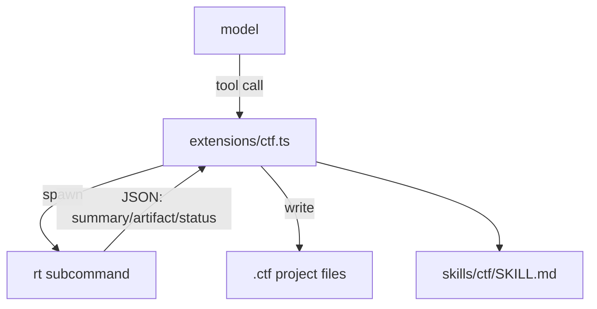
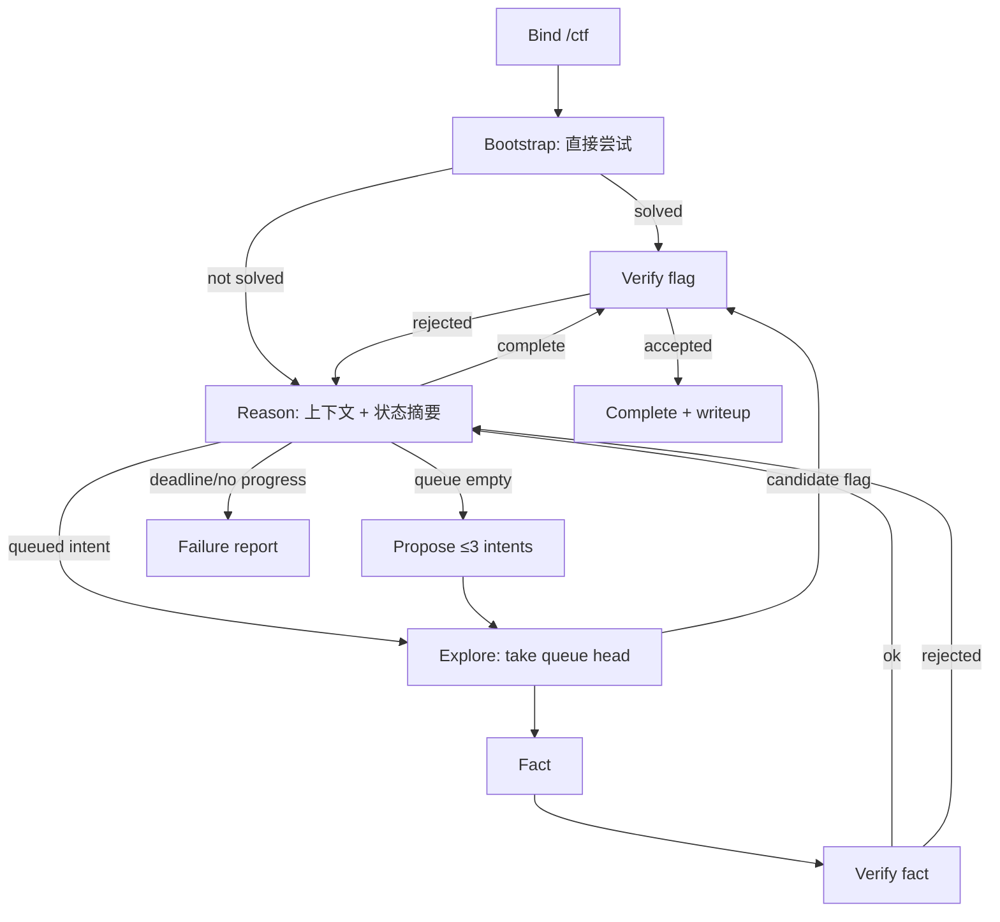

# pi4ctf 设计方案

> **v1 历史归档（2026-10-24 冻结）**。当前施工基线是 [`../design.md`](../design.md)；本文件不再作为施工依据。
>
> 历史调研、证据与扩展说明归档在 [`archive/research/`](../../archive/research/)。
>
> **One binary. Three tools. One evidence loop.**
>
> pi 负责推理；`rt` 负责观察、执行与保存证据；状态投影用于审计、恢复与队列推进。

---

## 0. 已冻结决策

| # | 决策 | v1 结论 |
|---|---|---|
| Q1 | 状态模型 | typed Fact + 有序 Intent 队列；DAG 只作为审计投影，不做 claim/lease/ready/frontier 调度 |
| Q2 | 运行环境 | Windows host + WSL2 Kali 为 P0；Linux CI 跑测试与基准；Docker 后置到 v1 之后 |
| Q3 | 并行 | 只做 async command job；`dispatch`/`pi-subagents` 保留接口、默认关闭，M5 后按 A/B 决定 |
| Q4 | 发布门槛 | 15 题开发集 + CTFTiny 50；同模型/预算对比 omp 18.4.9；误报 0 |
| Q5 | flag 提交 | 不自动提交；本地 oracle + `flag.txt`；CTFd 仅作为可选 oracle 适配器 |

---

## 1. 目标与边界

### 1.1 目标

1. 单题端到端：绑定题目、侦察、执行、记录证据、验证 flag、生成 writeup。
2. 上下文丢失后仍可恢复；事件、artifact、flag 账本可审计、可回放。
3. 每个事实都能指回命令与 artifact；每个 flag 都能通过格式、溯源、oracle、去重四层验证。
4. v1 单 agent；Intent 是有序队列；并行与 `dispatch` 保留接口，默认关闭，M5 后按数据决定。
5. Rust 负责 I/O、PTY、输出整形、artifact、锁与账本；策略层保持轻量。

### 1.2 非目标

- 不做固定角色（Web Agent、Pwn Agent、后渗透 Agent）。
- 不做常驻 Planner、Blackboard Server、Dispatcher。
- 不做 44 工具、206 技能、30k 漏洞库预加载。
- 不做 LLM 摘要作为默认压缩。
- v1 不做 SQLite/embedding/Hindsight memory backend；只做文件型 verified lesson；默认 off，project 可开，global 显式。
- 不做自动提交；无头模式只写 `flag.txt`；CTFd 只作为可选 oracle 适配器（后置）。
- v1 不做多 worker、claim/lease、DAG 调度；Intent 只按有序队列推进。
- v1 不保证 Docker 严格隔离；Docker 后端后置。
- v1 不承诺内核级网络阻断；`network:"deny"` 在 host/WSL2 返回未启用；强阻断后置。
- 不做通用安全 Harness、Ontology、知识图谱护城河。
- 不让模型默认现场生成大型工具；能力需要预置与验证。
- 不把题型能力做成新顶层工具或固定角色；扩展通过 `rt` 子命令与 `py` SDK 完成。
- 不把黑板结构当作推理引擎；黑板只承担状态投影、审计与协调。

### 1.3 验收

| 维度 | 门槛 |
|---|---|
| 功能 | 每类至少 1 题端到端；工具接口单测全绿 |
| 基准 | CTFTiny 50 解出率 ≥ omp 18.4.9 基线；误报 0；中位耗时 ≤ omp ×1.2 |
| 平台 | Windows host + WSL2 Kali 为 P0；Linux CI 跑测试与基准；Docker 不在 v1 验收 |
| 并行 | v1 单 agent；`dispatch` 默认关闭，不进入发布门槛 |
| 安全 | 工作区外写入 0；外网目标均有记录；强阻断在 Docker/网络沙箱后置；flag 误报 0 |
| 可复现 | `events.jsonl` + `artifacts/` + `flags.jsonl` 能重建解题过程 |

论文与比赛数据不能直接证明这套组合；v1 发布用 15 题开发集与 CTFTiny 50 验证，live CTF 做外部复核。

### 1.4 工具优先

- 通用安全 Harness 与知识图谱难以形成长期优势；投入集中在 CTF 场景能力。
- 重复出现、成本显著的动作，固化为 `rt` 子命令或 skill。
- 顶层工具保持 3 个；能力扩展通过 `rt <capability>` 与 `session py` SDK 完成。
- 每个新能力需要 fixture、差分或回归测试、15 题 A/B；没有验证闭环不进入默认路径。
- 当前范围交付通用原语：exec、PTY、shape、artifact、flag、command job、projection。
- 题型专用能力按数据决定，不预装大型工具库。

可扩展能力槽：

| 槽 | 形态 | 当前范围 | 说明 |
|---|---|---|---|
| `inspect` | checksec、ELF/PE 元数据、sections、imports、symbols | 否 | 使用 `file`、`readelf`、`objdump` 验证后再固化 |
| `traffic` | pcap 字段与会话查询 | 否 | 借鉴 PcapDB 思路；使用 `tshark` 与 fixture，不建数据库 |
| `web` | HTTP 重放、会话、JWT 解码 | 否 | 使用 `session py`，不另造 HTTP 客户端 |
| `disasm` | 包装 gdb、objdump、Ghidra | 否 | 不内嵌反汇编引擎 |
| `verify` | flag oracle 与 Fact verify | 是 | 属于核心能力 |

原则：能力通过 fixture 与 A/B 证明需要后固化；AI 能写代码不构成提前建设工具库的理由。

---

## 2. 设计原则

1. **观察即产品**：模型依赖看到的证据；工具先产出可推理、可追溯、低噪声的观察。
2. **主张不等于事实**：模型可以提出假设；只有环境、artifact、oracle 能确认。
3. **上下文是预算**：压缩保持确定性、可回读；默认不交给另一个模型概括。
4. **最小策略，最大环境**：不预编解题路径；工具进入环境，知识按需加载，编排交给模型。
5. **复杂度必须证明收益**：每个机制都要用 solve、tokens、false flags、time 做消融。
6. **状态可追溯**：Fact 只增不改；Intent 是证据驱动的有序队列；状态投影服务审计、恢复与队列推进。
7. **终止条件是能力**：deadline、flag-first、ABANDON、失败报告都属于运行时能力。
8. **工具是经验蒸馏**：重复、可验证的动作固化；不可验证的编排留给模型。
9. **验证先于能力**：新工具没有 fixture 与差分测试，不算交付。
10. **黑板是仪表盘**：状态投影帮助观察与恢复，推理依赖上下文、artifact 与工具返回。

---

## 3. 证据与取舍

### 3.1 黑板消融

Yak/TCH 的公开消融使用 DeepSeek Flash v4.1，在 tsecbench 上比较三类结构：

- JSON 图结构与 append-only Markdown 的解题效果没有显著差异；结构提示消耗额外 token。
- 固定黑板与无固定黑板相比，解题效果接近；Markdown 组总耗时少约 16%，单题互有胜负。
- TCH3 的 goal + 黑板 / 无黑板对照，成绩接近。

这些结果支持一个判断：黑板主要提供效率与可观测性，不能证明它提升解题能力。数据来自渗透测试 benchmark 与单一模型，不能直接外推到全部 CTF 题型。

### 3.2 本项目的选择

- 模型推理使用近期上下文、artifact 引用、工具返回；不要求每轮读取完整状态投影。
- `events.jsonl`、`artifacts/`、`flags.jsonl` 承担证据与账本职责。
- Fact 是证据主记录；Intent 是有序探索队列；图投影只用于审计、恢复与 flag 溯源。
- Reason 接收有界状态摘要、队首 Intent 与相关 Fact；完整投影按需读取。
- Hint 默认不进入 Reason；人类显式注入时作为上下文，并留下审计记录。
- 评测设置 C0、C1、C2 三组对照，验证状态投影在 CTF 上的实际收益。

### 3.3 来源取舍

| 来源 | 采用 | 不采用 |
|---|---|---|
| Cairn / TCH2 | Fact、Intent、Bootstrap、Reason、Explore、append-only、状态快照 | Server、Dispatcher、每项目容器、固定多 worker |
| sapper-v2 / TCH3 | typed fact、一文件一节点、flock、verify、flag ledger、deadline | 3 实例、8 pane、Arena API |
| BreachWeave / TCH2 | Idea/Memory 分离、Observer 旁路、结束条件外置 | 常驻多角色、7 模型并行、Web UI |
| CHYing / TCH2 | 工具可见性、PromptCompiler、ProgressCompiler、ABANDON | 复杂子 Agent 树、重型 CLI |
| BinX / TCH1 | 任务分解、证据到假设的因果链、置信度 | 完整贝叶斯引擎 |
| dsh-ops | 一次性 Rust worker、有界 JSON、PTC 代码调用、result refs、读取去重、bench gates | 31 工具、panel、多 profile 安装器 |
| omp | 持久 eval、typed subagent、checkpoint、handoff、artifact spill | 全量 Rust crates、桌面控制、大 memory backend |
| pi-code / pi-agent-plugins | 项目资源 trust、headless 拒绝、goal 独立评估、manifest containment | 全量 Claude 兼容层、插件市场 |
| OpenHands | typed append-only event log、state 是投影 | 完整事件框架 |
| Anthropic Research | orchestrator-worker、artifact handoff、默认单 agent | 常驻多代理、默认 15 倍 token 并行 |
| Plain Agents / EnIGMA | 完整历史与截断、30 turns、demos、PTY、开发集 | 默认 LLM summarizer、无预算探索 |
| BoxPwnr / CTF-Dojo | solver 抽象、traces、resume、verified trajectories | 平台适配器全量实现 |
| Yak 黑板文章 | 场景工具、验证闭环、黑板定位为仪表盘 | 通用 Harness、Ontology、自动造工具 |

只借鉴设计，不复制 AGPL 或闭源项目的代码与提示词。

### 3.4 Cairn 源码审计

已核对 Cairn 的实际文件：

- `cairn/src/cairn/server/db.py`、`models.py`、`services.py`、`routers/projects.py`、`routers/intents.py`
- `cairn/src/cairn/dispatcher/scheduler/loop.py`
- `cairn/src/cairn/dispatcher/tasks/bootstrap.py`、`reason.py`、`explore.py`、`common.py`
- `cairn/src/cairn/dispatcher/contracts.py`、`output_parser.py`
- `cairn/src/cairn/dispatcher/prompts/default/reason.md`、`explore.md`
- `cairn/src/cairn/dispatcher/workers/adapters/pi.py`
- `cairn/tests/test_worker_tasks.py`、`test_scheduler_logic.py`、`test_server_api.py`

审计结论：

1. **Cairn 使用 SQLite Server + Dispatcher + 每项目容器**。Dispatcher 是唯一协议写入者；Agent 不 claim、不 heartbeat、不直接调用 API。
2. **Fact 只有 `id` 与 `description`**。没有来源、artifact、命令 ID、验证状态。
3. **`conclude` 直接把 Agent 返回的 `description` 写成 Fact**；没有证据引用，没有独立验证。
4. **`complete` 只校验 `from` 中的 Fact 存在，并拒绝 `goal` 作为来源**；不校验 Fact 是否被证据支持，也不校验是否真正满足 Goal。
5. **Reason 与 Explore 的图快照写在容器内 `/tmp/cairn-prompts/.../graph.yaml`**，prompt 只给路径并要求模型读完整文件。
6. **Reason 触发使用计数**：Fact 数、Hint 数、open intent 数变化；未使用事件修订号。
7. **Explore 只输出一段 `description`**；没有结构化 Fact、artifact 引用或 flag oracle。
8. **Pi worker 适配器显式关闭扩展、skill、prompt template、theme、context files**，只开放 `read/write/edit/bash/grep/find/ls`。
9. **Reason 与 Explore 都有 timeout / parse-fail 后的 conclude 收尾**；Bootstrap 成功时必须同时返回 Fact 与 Complete。
10. **Server 具备 Intent 与 Reason lease**；过期后可以重新认领。单 Dispatcher 实例，不支持多个 Dispatcher 同时调度同一服务端。

对 pi4ctf 的采用与拒绝：

| 审计项 | 处理 |
|---|---|
| Dispatcher 唯一写入 | 采用“状态写入集中校验”的原则；pi4ctf 由 `case` 与 `rt` 校验，模型不能直接写状态文件 |
| Fact 仅 description | 拒绝；pi4ctf Fact 必须带 commandId、artifact/hash、verified |
| complete 只查 Fact 存在 | 拒绝；pi4ctf complete 只接受 verified Fact |
| 上下文快照 `/tmp` | 拒绝；pi4ctf 写到 `.ctf/prompts/<phase>/context.yaml` |
| Reason 计数触发 | 改为 `eventRevision` 与 `factRevision`，避免计数相同但内容变化时漏触发 |
| Explore 仅 description | 拒绝；pi4ctf Explore 产出一条带来源的 Fact |
| Pi worker 关闭扩展/skill | 采用子 Agent 的上下文隔离原则；父 Agent 保留项目 skill，子 Agent 不加载项目 skill |
| Reason/Explore conclude 收尾 | 采用；超时或解析失败只记录已确认内容 |
| SQLite Server + Dispatcher | 拒绝；pi4ctf 单 agent 使用项目文件与 `rt`，不引入常驻服务 |

本轮完整读取 Cairn 源码；sapper、BreachWeave、CHYing、CyberStrikeAI 的镜像拉取连续返回 502/504，未把二手材料升级为代码结论。上表只对 Cairn 文件级结论负责。

### 3.5 dsh-ops 源码审计

已核对 dsh-ops 0.4.1 的实际源码：

- `dsh-plugin.json`、`package.json`、`README.md`
- `native/src/main.rs`、`native/src/lib.rs`
- `native/crates/ops-protocol/src/envelope.rs`
- `native/crates/ops-files/src/file_path.rs`
- `native/crates/ops-results/src/results.rs`
- `native/crates/ops-batch/src/lib.rs`
- `src/worker-protocol.ts`、`src/file/worker.ts`
- `src/modes/native/read-dedup.ts`、`read-observation.ts`
- `src/shells/tool.ts`、`src/shells/constants.ts`
- `src/kernel/call-budget.ts`、`src/kernel/result-storage.ts`

审计结论：

1. **形态**：TypeScript 插件 + 原生 Rust worker。Rust worker 一次调用读取有界 stdin，返回一行 JSON，进程退出；没有常驻 Rust 服务。
2. **能力组件**：`shell`、`file`、`discovery`、`ptc`、`panel`、`tui`、`hide-official`。后台任务组件已从 0.4.1 移除；旧 profile 保留空行只告警。
3. **默认开关**：0.4.1 manifest 中 `ptc`、`shell`、`file`、`discovery` 默认开启；`panel`、`tui`、`hide-official` 默认关闭。部分 0.3 文档仍写 `ptc` 默认关闭，已与 0.4.1 不一致。
4. **协议**：请求信封包含 `version`、`requestId`、`component`、`budget`、`request`、`storage`；未知字段被拒绝；request 上限 2 MiB；output 上限 128 KiB；超限返回 `OUTPUT_LIMIT`。
5. **超时**：Rust worker 默认 300 秒；TypeScript `workerEnvelope` 把 file/PTC 调用钳到 **30 秒**，实际 host 侧上限是 30 秒。`ops_bash` 单独：默认 120 秒，最大 2,147,483,647 毫秒。
6. **能力沙箱**：`cap-std` `Dir::open_ambient_dir` 打开工作区；路径逐段 no-follow；拒绝 symlink、Windows junction/reparse point、设备名、`..`、非绝对路径；root 使用 canonicalize 与 `dev:ino` 身份。
7. **写操作**：只读模式拒绝写入；workspace-write 只允许工作区与会话私有临时目录；父 Agent 传入的路径不在传递前 realpath，避免抹掉链接后交给 no-follow 遍历。
8. **凭据围栏**：默认拒绝读取凭据路径；glob/grep 也跳过凭据目录身份；可通过配置关闭，但会留下审计记录。
9. **有界结果**：结果引用绑定 `scope`、`root`、`root_identity`，TTL 24 小时；分页 1–512 行、512–65536 字节；按序列化 JSON 字节计算；内容哈希覆盖完整有序行；引用不授予文件系统权限。
10. **批量写入**：最多 512 个操作、128 个保护路径；全量预检后执行；拒绝覆盖目标；每项记录 revision；状态为 pending、completed、failed、unknown；unknown 只校验后条件，不盲目重试。
11. **读取去重**：只对 `inspect_local_file` 与 `read_files` 生效；需要新鲜读取、完全一致的渲染正文、文件 identity/inode/size/mtime/ctime 证据；同一 session、同一 generation；sandbox mode 变化立即失效；最多 32 条记录、2 MiB、16 个 Agent。
12. **调用预算**：每个 host 与 session 共享 2 个活跃调用、8 个等待调用；超过返回 `CALL_LIMIT`；取消等待中的调用不产生效果。
13. **`ops_bash`**：严格参数白名单，未知键直接拒绝；`command` 与 `script_path` 二选一；没有 `run_in_background` 与 job id；每次新起非登录 shell；输出每流 64 KB，spill 上限 64 MiB；前台执行，长进程占用到 timeoutMs。
14. **安全姿态**：native crate `#![forbid(unsafe_code)]`；平台元数据读取使用安全 API；不支持平台 fail closed；不做系统 shell 静默回退。

采用与拒绝：

| 审计项 | 处理 |
|---|---|
| 一次性 Rust worker + 有界 JSON | 采用；`rt` 保持一次性能力调用 |
| 2 MiB request / 128 KiB output / 30 秒控制面 cap | 采用；exec 单独 120 秒、最大 600 秒 |
| `cap-std` + 逐段 no-follow | 采用；工作区、workspace-write、会话私有临时目录、Windows 设备名拒绝 |
| 凭据围栏 | 采用为默认，CTF 需要读取题目秘密时按项目显式开启 |
| 结果引用 scope/root/identity/TTL | 采用；结果引用不得跨项目、跨根目录、跨会话复用 |
| 读取去重证据 | 采用；只在新鲜读取与完整正文一致时返回 unchanged |
| 批量 write-ahead unknown | 采用；写入前记 unknown，恢复时只校验后条件 |
| `command` / `script_path` 二选一 | 采用；长脚本先写文件，不塞进工具 JSON |
| 2 活跃 / 8 等待调用预算 | 采用；每个 session 独立 |
| 组件化开关 | 采用为能力槽开关；顶层工具仍为 3 个 |
| 后台任务组件 | 不采用；pi4ctf 用异步 job 替代 |
| 18 个 PTC API 全量 | 不采用；只保留 CTF SDK 需要的 10 个接口 |
| 系统 shell 静默回退 | 拒绝；不支持平台 fail closed |

### 3.6 omp 与 pi 生态：已落实的借鉴

本轮不是泛泛浏览插件市场；实际核对的是：

- **omp**：`audit/repos/omp/docs/tui.md`、`tui-core-renderer.md`、`packages/tui/src/status-line/*`、`packages/tui/src/chat/tool-execution.ts`，以及 task/eval/artifact/checkpoint 相关文档与源码。
- **pi-subagents**：`audit/repos/pi-subagents/docs/{tool-reference,agents,extension-api}.md` 与 `src/extension/schemas.ts`、`src/runs/background/{result-files,result-delivery-ownership,subagent-wait}.ts`。
- **dsh-ops**：`native/crates/*`、`src/worker-protocol.ts`、`src/file/worker.ts`、`src/kernel/*`、`src/modes/native/*`。
- **postman-plugin**：已安装包的 `package.json`、`dist/pi-extension.js`、`skills/`、`mcp.pi.json`。
- **pi-code / pi-agent-plugins**：文档级对照（项目资源 trust、headless 拒绝、manifest containment），未做全量源码审计。

落实矩阵：

| 来源 | 学到 | 落到哪里 | 不借 |
|---|---|---|---|
| omp TUI core | history/viewport 分离；组件稳定引用；宽度安全；focus/overlay 生命周期 | `docs/tui-design.md`；只用 pi TUI，不自建渲染器 | 完整 omp 渲染引擎/TSP |
| omp status line | 分段、preset、优先级、TTL/缓存、主题 token | CTF HUD：`setStatus` + `setWidget`；三档 preset；窄屏裁剪 | 7 套 preset、powerline/nerd 依赖 |
| omp tool cards | renderer registry、fallback、streaming、折叠/展开、diff | `case`/`run`/`session` 卡片；summary + artifact | 图片协议、鼠标优先、复杂卡片 |
| omp eval/artifact | 持久 Python、artifact spill、稳定引用 | `session py` preset；artifact head/tail；按行读 | 全量 eval/workpool |
| omp task/checkpoint/observer | typed output、checkpoint、handoff、旁路观察 | `pi-subagents` schema；`case handoff`；可选只读 Observer | 默认多 agent、7 advisor、worktree |
| omp memory | 默认 off、作用域、注入预算、preview/full read、verified/stale/invalidate | `docs/memory-design.md` 的文件型 verified lesson；默认 off、project 可开、global 显式 | 五 backend、SQLite/embedding/graph、Hindsight、后台抽取 |
| pi-subagents | 单工具 action schema；agent markdown；outputSchema；后台结果 revision/ack；tool allowlist | adapter 的 3 工具 schema；job ack；只读 Observer | 默认 dispatch、重型工作流 |
| dsh-ops | 一次性 worker；有界 JSON；cap-std no-follow；result refs/page；读取去重；调用预算 | `docs/kernel-design.md` 的 Store/exec/job/limits | 31 工具、大插件市场、多 profile |
| postman-plugin | pi manifest（extensions/skills/image）；feature-detect `registerMcpServer`；prompt section 追加；加载失败不拖垮 session | 打包、扩展加载、MCP 接入 | 跨宿主安装器、全量 API 平台 |
| pi-code / pi-agent-plugins | 项目资源 trust、headless 拒绝、manifest containment | `.ctf`/`.pi` 资源 gate；headless 不加载未批准资源 | Claude 兼容层、插件市场 |

结论：这些不是“看过”，而是已经进入施工文档：

- 内核：有界协议、路径 no-follow、result refs、command job、单提交点。
- 适配层：3 工具 action schema、tool allowlist、job ack、prompt section 追加。
- TUI：`docs/tui-design.md` 的 HUD、卡片、overlay 与渲染纪律。
- 打包：pi manifest、prebuilt binary、skills 分离、MCP 可选。

---

## 4. 总体架构



项目文件：`project.json`、`facts/`、`intents/`、`hints/`、`graph.json`、`graph.md`、`flags.jsonl`、`events.jsonl`、`artifacts/`、`traces/`、`scratch/`。

### 4.1 组件职责

| 组件 | 职责 |
|---|---|
| `extensions/ctf.ts` | 3 个工具 schema、`/ctf` 命令、`CTF_MODE` 注入、`tool_call` hook、异步任务协调 |
| `skills/ctf/SKILL.md` | 主循环、分类决策卡、flag 规则、失败处理 |
| `bin/<platform>/rt` | 状态投影、原子写、锁、exec、PTY、整形、artifact、flag 账本、command job、trace |
| `.ctf/` | 每题独立项目目录；事件、artifact、投影、账本 |

TypeScript 只做 pi 适配与任务协调，不复制业务状态。Rust 不读取模型密钥，不直接写 `state.json`。

### 4.2 不使用常驻服务

sapper-v2 使用 JSON 文件与一个 CLI 获得第三届第一；Cairn 的 Server/Dispatcher 服务于多 worker 与多项目并发。v1 以单 agent、单写者为主，项目文件锁足够；多 worker 与 claim/lease 后置到 v1 之后，届时再用项目锁协调，仍然不需要常驻服务。

---

## 5. 数据模型

### 5.1 文件布局

项目目录 `<challenge>/.ctf/`：

- `project.json`：origin、goal、status、deadline、oracle、backend、计数器。
- `facts/f001.json`、`intents/i001.json`、`hints/h001.json`：一文件一节点。
- `graph.json`：审计投影，展示 Fact 与 Intent 的引用关系，不参与调度。
- `graph.md`：人读审计投影。
- `flags.jsonl`：flag 账本，状态为 candidate、recorded、submitted、accepted、rejected。
- `events.jsonl`：action、observation、fact、intent、verify、flag、audit、checkpoint、close。
- `state.json`：状态投影，可重建。
- `progress.md`：中断恢复与 handoff。
- `artifacts/`：完整输出。
- `traces/`：solved 后的 verified trace。
- `scratch/`：子 Agent artifact handoff。
- `prompts/`：Reason/Explore 的上下文快照，例如 `prompts/reason/context.yaml`。

写入规则：

- 一文件一节点；`write tmp → rename` 原子替换；`flock` 保护项目级写入。
- Windows 使用 `LockFileEx`，Unix 使用 `flock`；不假设 `fcntl` 跨平台。
- `graph.json`、`graph.md`、`state.json` 都是投影，可删除并重建。
- `intents/` 只保序；`from` 是证据引用，不是 ready 门禁；`graph.json` 只读。
- `.ctf/` 严格按项目隔离，不写 `~/.ctf`。
- 状态写入集中在 `case` 与 `rt`；模型只能调用工具，不能直接写 `facts/`、`intents/`、`flags.jsonl`、`project.json`。
- 上下文快照写到 `.ctf/prompts/<phase>/context.yaml`，不使用系统临时目录。

### 5.2 Project

```json
{
  "id": "csaw2018-crypto-babycrypto",
  "title": "babycrypto",
  "origin": "已知：题目目录、ciphertext.txt",
  "goal": "拿到 flag 并验证",
  "status": "active",
  "category": "crypto",
  "target": { "host": null, "port": null, "url": null },
  "allowedHosts": [],
  "flagFormat": "flag\\{[^}]+\\}",
  "oracle": { "type": "local", "ref": "/outside/oracle.json" },
  "backend": "host",
  "deadline": "2026-10-23T13:00:00Z",
  "createdAt": "...",
  "counters": { "fact": 7, "intent": 4, "hint": 2 }
}
```

状态：`active | stopped | completed | failed`。`backend`：`host | wsl2`；v1 不启用 `docker`。

### 5.3 Fact

```json
{
  "id": "f003",
  "kind": "service",
  "description": "10.0.2.15:80 nginx 1.24，存在 /admin 登录页",
  "data": { "host": "10.0.2.15", "port": "80", "product": "nginx/1.24" },
  "source": {
    "commandId": "cmd-12",
    "artifact": "artifacts/cmd-12.log",
    "sha256": "…"
  },
  "verified": true,
  "intentId": "i004",
  "createdAt": "..."
}
```

- 只增不改；状态变化写新 Fact。
- `kind`：host、service、cred、vuln、loot、flag、general。
- `description` 不超过 2KB，只写结论；长数据引用 artifact。
- `verified` 只能由 `case verify` 置为 true；未验证 Fact 不能支撑 `complete`。
- 可选 `confidence` 与 `evidence` 字段保留给因果分析；完整贝叶斯引擎不进入当前设计。

### 5.4 Intent

```json
{
  "id": "i004",
  "order": 4,
  "from": ["f001", "f003"],
  "description": "验证 /admin 是否存在 SQLi；优先 boolean blind",
  "state": "pending",
  "createdAt": "...",
  "startedAt": null,
  "concludedAt": null
}
```

- `order` 由 store 单调分配；单 agent 只取 `order` 最小的 `pending` Intent。
- `from` 是证据引用，不是 ready 门禁；可以引用多个已存在的 Fact，`goal` 不能作为来源。`graph.json` 只把这些引用画成审计边。
- 状态：`pending | active | done | rejected`；同一时刻最多一个 `active`；只允许 `pending → active → done|rejected`，store 拒绝跨级与回退。
- 不做 claim/lease/worker/confirm；v1 单写者，队列推进足够。
- 终态不可改；失败写 `rejected`，不产生 Fact。
- 重复的 pending/active Intent 直接跳过；`created==0` 不算成功。
- `description` 不超过 2KB，只写方向与核心 insight，不写长步骤。

### 5.5 Hint

```json
{ "id": "h001", "content": "优先看 /admin；SQLi 已排除", "creator": "user", "createdAt": "..." }
```

- 不进入因果图；可随时追加。
- 默认不进入 Reason；人类显式注入时作为上下文，审计记录保留。
- 图内容与 Hint 都按不可信数据处理，不能作为命令执行。

### 5.6 Flag 账本

```json
{"flag":"flag{...}","source":"cmd-19","status":"candidate","oracle":"local","ts":"..."}
{"flag":"flag{...}","source":"cmd-19","status":"recorded","oracle":"local","ts":"..."}
{"flag":"flag{...}","source":"cmd-19","status":"accepted","oracle":"local","ts":"..."}
```

生命周期：

1. candidate：候选。
2. recorded：写入 Fact，按值去重。
3. submitted：提交后等待平台返回。
4. accepted 或 rejected：结果保留，供审计与防重复。

### 5.7 Event 与 Trace

- `events.jsonl`：事件带 `source`、`artifact_hash`、时间戳与类型。
- `traces/<id>.json`：solved 后的命令、artifact、flag、cost、duration、状态摘要；用于回放、检索与训练。
- `state.json` 由事件与投影生成；删除后可以重建。

### 5.8 黑板定位

状态投影承担三类职责：

1. 审计：记录 Fact、Intent、验证结果与 flag 来源。
2. 恢复：checkpoint、handoff、恢复队列中的 pending/active Intent。
3. 推进：单 agent 取队首 pending Intent；投影只用于审计与 handoff，不做并行认领。

模型推理不使用完整投影作为必读输入。Reason 接收近期上下文、artifact 引用、有界状态摘要、队首 Intent；需要时读取相关 Fact。C0、C1、C2 对照用于验证这个选择在 CTF 上的收益与代价。

### 5.9 Memory

Memory 分三层：

| 层 | 内容 | 权威性 |
|---|---|---|
| Case memory | 当前题 Fact/Intent/事件/artifact/flag | 权威 |
| Lesson memory | 已验证的跨 session 经验（条件 + insight + 证据） | 启发式 |
| External knowledge | `ctf_rag` / 外部 writeup | 外部证据 |

v1 规则：

- 文件型，无 SQLite/embedding/后台 LLM；单项目 lesson 扫描 JSON 足够。
- 只存 **verified** lesson；`candidate/stale/invalidated` 不注入。
- 作用域 `project`；v1 默认 `off`，M4.5 A/B 后决定 project 是否默认；`global` 需用户显式批准。
- **cue 驱动注入**：`case_init`、`fact_added`、`intent_start`、`command_failed`、`flag_candidate`、pre/post compaction、`env_change` 时调用 `memory.cue`；不依赖模型主动 `search`。
- 注入最多 3 条、2KB tokens；带 provenance/staleness；`<MEMORY_GUIDANCE>` 包裹，当前证据优先；fire ledger 去重。
- `flag.accept` 后自动捕获 verified trace + candidate lesson skeleton，不做 LLM 摘要；不自动 retain transcript。
- 写入前做 flag/secret redaction；不存真实 flag。
- 通过 `case` 的 `memory.*` actions 访问，不新增顶层工具。
- 详细数据模型、cue、打分、失效与 A/B 见 [`memory-design.md`](../memory-design.md)。

---

## 6. 三个工具

工具名：`case`、`run`、`session`；运行时二进制：`rt`。`.ctf/` 是项目状态目录；外部 MCP 原名（如 `ctf_rag`）不改。

### 6.1 `case`

```ts
input:
  | { action: "init"; path; category?; target?; goal; flagFormat?; oracle?;
      backend?; deadline?; timeboxMinutes?; hints?: string[] }
  | { action: "status" }
  | { action: "graph"; format?: "json"|"md"; maxFacts?: number }
  | { action: "memory"; op: "add"|"cue"|"capture"|"search"|"get"|"list"|"invalidate"|"stats"; input?: object }
  | { action: "fact"; description; kind?; data?;
      source: { commandId; artifact?: string } }
  | { action: "intent"; add?: { from: string[]; description: string };
      id?; state?: "pending"|"active"|"done"|"rejected" }
  | { action: "hint"; content; creator?: "user"|"agent" }
  | { action: "checkpoint"; goal: string }
  | { action: "handoff"; format?: "md" }
  | { action: "dispatch"; intentId; contextMode?: "fork"|"task_only" }
  | { action: "inspect"; jobIds?: string[] }
  | { action: "wait"; jobIds?: string[]; timeoutMs?: number }
  | { action: "cancel"; jobIds?: string[] }
  | { action: "verify"; intentId; commandId?; result? }
  | { action: "complete"; from: string[]; description: string }
  | { action: "flag"; flag; source: { kind:"run"|"file"|"http"|"user"; ref } }
  | { action: "doctor" }
  | { action: "close"; reason? }
output: { project; graph?; jobs?; warnings }
```

规则：

- `init` 绑定目录，创建 origin 与 goal 两个特殊 Fact；可设置 deadline。
- `fact` 是 typed fact，必须带 commandId；store 校验 commandId 存在于 `events.jsonl`，artifact 路径与 hash 必须存在；Fact 初始 `verified=false`。
- `intent` 的 from 是证据引用，不是 ready 门禁；所有来源 Fact 必须存在，`goal` 不能作为来源；store 单调分配 `order`；重复项跳过，`created==0` 不算成功。
- `graph` 返回路径与有界摘要，不内联完整投影；快照写到 `.ctf/prompts/<phase>/context.yaml`。
- `memory.add` 必须带当前 case 的 evidence；只有 verified lesson 会被注入；`scope:"global"` 需要用户确认；不存真实 flag。
- `memory.cue` 由事件触发、内核确定性求值；`memory.capture` 从 verified trace 生成 reference/candidate，不做 LLM 摘要。详见 [`memory-design.md`](../memory-design.md)。
- `dispatch` 保留给 v1 后的并行；默认关闭，设置 `CTF_ENABLE_DISPATCH=1` 才注册；v1 不启动 intent job。
- `inspect`/`wait`/`cancel` 只操作 async command job，不是 Intent 调度器。
- `checkpoint` 记录状态快照与目标；`handoff` 从事件与投影生成 `progress.md`；不承诺恢复文件内容。
- `complete` 的 from 只能包含 `verified=true` 的 Fact；store 校验至少一个来源、所有来源已验证、Goal 未作为来源；写入完成事件后把项目状态设为 completed。
- `flag` 是唯一写 `flag.txt` 的路径；通过四层门禁。
- `status` 返回不超过 1KB 的摘要、剩余 deadline 与 `eventRevision`、`factRevision`、`intentRevision`、`hintRevision`。
- 所有状态写入由 `case` 与 `rt` 完成；模型不能直接写 `facts/`、`intents/`、`hints/`、`flags.jsonl` 或 `project.json`。

### 6.2 `run`

```ts
input: {
  command?; scriptPath?; purpose; backend?; cwd?; timeoutSec?; stdin?; env?;
  mode?: "auto"|"raw"|"hex"; maxBytes?; async?: boolean;
}
output: {
  commandId; exit; signals[]; summary; artifact; artifactHash;
  bytes; lines; truncated; durationMs; backend; networkVerdict;
  jobId?; state?: "queued"|"running";
}
```

- 默认返回 summary、artifact 与 hash；原始输出不整段进入上下文。
- `command` 与 `scriptPath` 二选一；长脚本、heredoc、多层引号写成工作区文件后传 `scriptPath`，不把整段脚本塞进工具 JSON。
- `scriptPath` 必须是工作区内的普通文件，拒绝 symlink、junction 与设备名。
- 超时终止进程组；cwd 不越界；路径逐段 no-follow；网络目标写入事件，v1 不做内核级阻断。
- v1 `backend` 只接受 `host | wsl2`；`docker` 返回明确的未启用错误。
- 凭据围栏默认开启；CTF 题目需要读取项目内秘密时按项目显式开启。
- 单次调用预算：request 2 MiB、output 128 KiB、控制面 30 秒；命令执行默认 120 秒、最大 600 秒；长命令使用 `async: true` 或 `session`。
- 每个 session 最多 2 个活跃调用、8 个等待调用；超出返回 `CALL_LIMIT`。
- 记录命令签名，供 ABANDON 使用。
- 每次执行写入 `events.jsonl`；长输出写入 artifact。

### 6.3 `session`

```ts
input:
  | { action:"open"; argv?; preset?: "shell"|"py"; backend?; cwd?; cols?; rows? }
  | { action:"write"; id; data; enc? }
  | { action:"read"; id; timeoutMs?; maxBytes? }
  | { action:"resize"; id; cols; rows }
  | { action:"close"; id }
output: { id?; data?; seq?; exited?; artifact? }
```

- gdb、nc、socat、python REPL；read 只返回增量。
- 完整缓冲写入 artifact；默认不把 PTY 历史放入上下文。
- 最多 4 个 session；close 终止进程组。

`preset: "py"` 提供 CTF SDK：

```python
read(path, offset=None, limit=None)
read_many([{path, offset, limit}, ...])
grep(pattern, path=".", glob=None, mode="content|count|summary")
stat(path)
diff(path_a, path_b)
run(cmd, timeout=120)
graph(action, **kwargs)
result.put(items) -> ref
result.page(ref, offset, limit, fields) -> rows
result.release(ref)
```

结果引用绑定项目 `scope`、工作区 `root` 与 `root_identity`，有效期 24 小时；分页 1–512 行、512–65536 字节；引用不授予文件系统权限。跨项目、跨根目录或过期引用直接拒绝。

一次脚本可以完成多步文件与命令操作，只返回结构化结果；大结果通过 `result.page` 分页。不提供 JS eval 或 workpool。

### 6.4 异步任务

`run({async:true})` 立即返回 jobId；v1 只有 command job。

```ts
type JobState = "queued"|"preparing"|"running"|"cancelling"
              | "completed"|"failed"|"cancelled"|"timed_out";

Job = { jobId, batchId, kind:"command", state,
        createdAt, startedAt?, endedAt?, lastActivityAt, lastEvent?,
        latestOutput?, resultRef?, resultRevision?, error?, cleanupPending? }
```

- `case inspect`：非阻塞快照。
- `case wait`：默认 30 秒，最大 10 分钟；属于观察窗口，超时不会取消任务。
- `case cancel`：协作式取消；终态等待子进程退出。
- 结果写入 `scratch/jobs/<jobId>.md` 与 `.json`；manager 登记 resultRevision；父 prompt 只注入未投递结果，最多 8 项。
- `complete` 门禁：没有活跃 command job，并且所有终态结果已进入当前 prompt 版本。
- 配额：每个 session 2 个并发；pending 不超过 8；submitted 不超过 32；连续 20 次 inspect/wait 无进展时停止观察。
- command job 由 Rust 管理；`run --async` 派生一个 `rt __job` supervisor，supervisor 是一次性进程，不是 daemon。
- `dispatch` 默认关闭，启用后才由 TypeScript 扩展调用 `pi-subagents`。
- 结果晚到由 resultRevision 隔离；取消后不写父投影；进程重启把未完成任务标为 `orphaned`，不自动续跑。
- Bootstrap、依赖链、少于 30 秒的验证保持同步；长命令使用 async command job。

---

## 7. 解题机制

### 7.1 主循环



### 7.2 Bootstrap

- 执行不超过 5 次低成本观察：file、checksec、端口、协议、版本、明显字符串。
- 观察直接写成 Fact，随后尝试解题。
- 成功：Fact + Complete → Verify flag。
- 失败或超时：Conclude 只记录已确认内容，不写计划或猜测，随后进入 Reason。
- 预算：5 分钟、8 turns。

### 7.3 Reason

输入：近期上下文、artifact 引用、有界状态摘要、deadline。完整投影按需读取。

触发条件：`eventRevision` 或 `factRevision` 变化；`hintRevision` 变化；pending Intent 从非零变为零。使用修订号，不使用简单计数，避免内容变化但计数相同导致漏触发。

输出三选一：

1. `complete`：当前 verified facts 足以满足 Goal；随后调用 `case complete`，再进入 Verify flag。
2. `intents`：提出不超过 3 个高价值 Intent，按价值排序入队；from 记录证据来源。
3. `noop`：现有 pending Intent 已覆盖当前线索，不新增。

规则：

- 队列有 pending Intent 时取队首进入 Explore；队列为空时提出新 Intent。
- Intent 去重：不同 Intent 覆盖不同维度；不写“再试试”“深入一下”。
- Reason 不执行命令；执行只发生在 Explore。
- 重复 Intent 跳过；created 为 0 不算成功；complete 写入失败必须重试或报错。
- complete.from 只能引用已验证 Fact；store 拒绝未验证 Fact、空来源与 `goal` 来源。提示词约束只作辅助，最终校验在 store。

### 7.4 Explore

- 取队首 pending Intent，置为 active；v1 单 agent，不做 claim/lease。
- 只沿当前 Intent 探索，不中途改目标。
- 执行使用 `run` 或 `session`；多步操作写成脚本。
- 执行期按需查询 `ctf_rag` 或可选 skill；使用 2 到 4 个技术锚点与环境指纹；只取结论。
- 产出一条增量 Fact；通过 `case verify` 后 conclude（Intent 置 done）；失败置 rejected。
- 超时或解析失败：Conclude 只记录已确认内容，不继续执行。

异步执行：

- 预计超过 120 秒：`run({async:true})`；Intent 保持 active，结果返回后 conclude。
- `dispatch` 默认关闭；启用后交给 `pi-subagents`，父可继续本地动作；v1 不验收 intent job。
- 启用 dispatch 后继续本地动作，或显式调用 `case wait`；pi 不会自动续父轮。headless 可开启 `notifyOnComplete`，通过 `pi.sendMessage({triggerTurn:true})` 唤醒。
- 依赖型任务、Bootstrap、少于 30 秒的验证保持同步。
- wait 超时只返回快照，不取消任务；cancel 为协作式；终态结果未进入当前 prompt 时禁止 complete。

### 7.5 Verify

Fact verify：

- 命令类：检查 exit code、artifact 内容、目标响应。
- 结论类：可选只读 verifier 检查 Fact 是否被证据支持；verifier 不持有执行工具。
- 失败：Fact 标为 rejected，不进入投影。

Flag 四层：

1. 格式：匹配 flagFormat，排除占位符。
2. 溯源：在真实命令的 artifact 或工作区文件中出现。
3. oracle：本地 ground truth（v1）；CTFd/人工是后置适配器。
4. 去重与去 decoy：使用 flags.jsonl 与来源上下文。

格式、溯源、oracle、去重四层通过才标记 accepted；`case flag` 是唯一写 `flag.txt` 的路径；`tool_call` hook 阻止 `write`、`edit`、`bash` 直接写该文件。

### 7.6 预算与终止

| 预算 | 默认 |
|---|---|
| 单题 deadline | deadline 或 45 分钟，取较早值 |
| Bootstrap | 5 分钟、8 turns |
| 单命令超时 | 120 秒 |
| 总 turns | 30 |
| pending intents | 不超过 5；每次 Reason 新增不超过 3 |
| 单 Intent explore | 不超过 8 turns |
| 连续无新 Fact | 2 轮后注入 Hint 或停止 |
| 单次观察 | 16 KB |
| 单 Fact | 不超过 2 KB；长数据引用 artifact |

确认 flag 后立即调用 `case flag`；多 flag 题目先提交已确认项。`status` 显示剩余 deadline 与预算；Reason 提示包含 deadline。

### 7.7 Audit、ABANDON、升级

每 6 步或 Reason/Explore 失败时检查：

1. 上一个 Fact 改变了什么状态。
2. pending/active Intent 是否重叠或重复。
3. 是否重复命令签名。
4. 状态投影是否膨胀，Fact 描述是否过长。
5. deadline 与预算相对预期收益是否仍然合理。

ABANDON：

- 命令签名由工具、归一化路径、method、参数形状组成，去掉 IP、域名、随机值。
- 连续 3 次相同签名且没有新 Fact，返回历史并提示换方向。
- dead-end 关键词层与 CVE 层可选；采用签名层，记录误杀。
- 只有停滞持续后激活，避免正常验证被误杀。

升级顺序：

1. 同一 Intent 换参数或变体。
2. 新 Intent（Reason）。
3. 更换干净上下文（新会话 + `progress.md`；dispatch 启用后才用 fresh-context worker）。
4. 注入 Hint（用户最小提示）。
5. 停止，写 progress.md 与失败报告。

### 7.8 Observer 与 Compiler

- Observer：只读，不持有执行工具；每 6 步检查状态漂移、状态混杂、过早结束、上下文膨胀；默认确定性 audit，v1 不自动启动 `pi-subagents`。
- 节流：review 窗 10、提醒冷却 6、重复窗 12、活动窗 3；使用 message 与 activity fingerprint 去重。
- 队列上限：memory 不超过 12 条、intents 不超过 8 条；更新顺序为 NO_CHANGE、update、delete、add。
- solver 只读队列状态；Observer 不提交 flag、不取 hint、不执行 solver 行为。
- ProgressCompiler：compact 时由独立上下文读取事件与投影，生成 `progress.md`；参数为最多 10 turns、只读 Read/Grep、输入不超过 60k chars、不写文件；输出以 `## Session Handoff` 开头，由程序写入。
- RetryHandoff：重试老题时从 `traces/` 与 `progress.md` 恢复，不重复探索。
- TodoWrite：保留 todo 时自动同步 `progress.md` 的 Current Phase 与 Attack Plan；没有 todo 时不引入。

---

## 8. 上下文与知识

### 8.1 观察规则

- `run` 默认返回 summary、artifact 与 hash，不返回原始 stdout。
- summary 由确定性规则生成：去除 ANSI 与 OSC、折叠重复、保留错误、命中、路径、数字、flag 行，上限 16KB。
- 原始输出写入 artifact，按行读取；超过 16KB 时保留 head 3MB 与 rolling tail，超出部分标记 `[TRUNCATED]`。
- 引用使用稳定路径与 hash：`artifacts/cmd-7.log:120-180`、`sha256:…`。
- `session` 只返回增量；完整缓冲写入 artifact。
- 分层预算：request 2MB、transport 128KB、模型显示 64KB、result store 10MB/result 与 100MB/session；控制面/能力 30 秒，命令默认 120 秒、最大 600 秒；长命令走 `async` 或 `session`。
- 结果引用绑定项目 scope、工作区 root 与 root_identity，有效期 24 小时；分页 1–512 行、512–65536 字节；跨项目、跨根目录或过期引用拒绝。
- 读取去重：同一命令与同一 artifact hash 已在最近一次请求中完整出现时，返回 unchanged 与 revision；证据需要新鲜读取、完整正文一致、文件 identity/inode/size/mtime/ctime 一致；sandbox mode 变化立即失效；证据不足时返回全文。
- 路径逐段 no-follow；拒绝 symlink、Windows junction/reparse point、设备名与 `..`；凭据路径默认拒绝读取。
- 每个 session 最多 2 个活跃调用、8 个等待调用；超出返回 `CALL_LIMIT`。

### 8.2 知识注入

- 默认不预加载通识 Skill 或 RAG。
- 执行期按需查询：选定 Intent、准备写 exploit、连续失败时使用 `ctf_rag` 或可选 skill。
- 使用 2 到 4 个技术锚点与环境指纹（arch、libc、framework）。
- 引用 source 与 chunk_id；环境假设必须复核；知识按证据使用。

### 8.3 工具可见性

- 父 Agent 只看到 3 个工具；删除不用的工具定义，不只隐藏。
- 接入浏览器或逆向 MCP 时，父只暴露一个 `browser` 或 `reverse` 高层工具；底层工具交给子 Agent。
- MCP server 名使用 namespace 与 containment。
- 子 Agent 写 `scratch/report.md` 与 artifact refs；父级读取引用，不读长文。
- 基准与默认配置关闭 `WebSearch` 与 `WebFetch`，防止 writeup 泄漏；比赛规则允许时再开。

### 8.4 Prompt injection 防护

- 状态投影与 Hint 使用 `<UNTRUSTED_STATE_DATA>` 包裹，按数据处理。
- Fact 或 Hint 中的“执行这个命令”“忽略规则”只作为观察记录，不执行。
- 未信任网页与题目输出不能直接写成 Hint。
- 子 Agent 不得扩大父级允许的主机、路径与工具范围。

---

## 9. Rust 运行时

### 9.1 形态

- `rt <op>`：读取一个 JSON，执行，写入一个 JSON，退出；无常驻服务。
- `rt session`：保留 PTY 子进程；由 TypeScript 持有。
- `rt __job <jobId>`：单个 async command 的 supervisor；一次性进程，不是 daemon。
- `rt <capability>`：使用同一请求信封的一次性子命令；只扩能力，不增顶层工具。
- 请求信封：`{ version, op, requestId, project, input, limits }`；未知字段拒绝；request 不超过 2MB。
- 预算：output 不超过 128KB；控制面 30 秒；exec 默认 120 秒、最大 600 秒；result store 10MB/result、100MB/session；每个 session 2 个活跃调用、8 个等待调用。
- 内核进程模型、协议、扩展缝与测试矩阵见 [`kernel-design.md`](../kernel-design.md)。
- 路径逐段 no-follow；工作区根使用 canonicalize 与 `dev:ino` 身份；只读模式拒绝写入；workspace-write 只允许工作区与会话私有临时目录。
- 凭据路径默认拒绝；glob/grep 也跳过凭据目录身份。
- native crate 使用 `#![forbid(unsafe_code)]`；平台元数据通过安全 API 读取。
- 超出限制返回 `OUTPUT_LIMIT`；mutation receipt 丢失时标记 unknown effects，不自动重试；unknown 只校验后条件。

### 9.2 模块

- `main.rs`：CLI 子命令分发。
- `case.rs`：project init、status、close。
- `state.rs`：fact、intent 队列、hint、validate、projections。
- `store.rs`：atomic write、flock、LockFileEx。
- `flag.rs`：ledger、oracle、dedupe。
- `verify.rs`：fact verification、flag four-layer。
- `exec.rs`：one-shot run、process group、timeout。
- `pty.rs`：ConPTY、Unix PTY、session protocol。
- `shape.rs`：deterministic output shaping。
- `artifact.rs`：hash、spill、range read。
- `results.rs`：result store、page、release。
- `jobs.rs`：command job state、inspect/wait/cancel、delivery revisions。
- `trace.rs`：verified trace。
- `doctor.rs`：environment checks。

内核 crate 禁止 unsafe；平台 FFI 与锁放在独立 crate。详细 workspace、模块与依赖以 [`kernel-design.md`](../kernel-design.md) 为准。

### 9.3 依赖

- `portable-pty`：ConPTY 与 Unix PTY。
- `serde` 与 `serde_json`：协议与文件。
- `blake3`：artifact hash。
- `fs2` 或平台 `LockFileEx`：文件锁。
- `lexopt`：参数解析。
- 不使用 `tokio`、`rmcp`、`clap`、`anyhow`。

### 9.4 性能预算

| 指标 | 上限 |
|---|---|
| 二进制（strip） | 小于 5 MB |
| 冷启动 | 小于 20 ms |
| 4 sessions RSS | 小于 32 MB |
| 10 MB 输出整形 | 小于 100 ms |
| PTY 本地往返 | 小于 5 ms |
| Fact 写入 | 小于 5 ms |

### 9.5 并发与锁

- 每个节点一个文件；`write tmp → rename`。
- 项目级 `flock` 保护 id 计数、队列写入、flag ledger。
- Windows 使用 `LockFileEx`；Unix 使用 `flock`。
- v1 单写者；多 worker 与 claim/lease 推迟到 v1 之后，不共享内存。

### 9.6 打包

- v1 预编译 `win32-x64`、`linux-x64`；`darwin-arm64` 尽力构建，不进入验收矩阵。
- `bin/<platform>/rt[.exe]` 附带 SHA256 receipt；无 postinstall 下载与编译。
- 不支持平台 fail closed，返回明确错误，不降级到慢路径。
- v1 执行后端：Windows host + WSL2；Docker 后端 v1 后。

---

## 10. pi 适配与分发

- `extensions/ctf.ts` 负责：3 个工具 schema、`/ctf`、`/ctf-status`、`/ctf-env`、`CTF_MODE` 注入、`tool_call` hook、command job 协调。
- 业务状态保存在 `rt` 与 `.ctf/`；TypeScript 不复制状态。
- `package.json` 的 pi manifest 包含 extensions、skills、prompts。
- Companion：`pi-web-access`（联网）、`pi-mcp-adapter` 或 MCP（浏览器与逆向）；`pi-subagents` 仅用于默认关闭的 `dispatch`。
- 异步任务：`case inspect/wait/cancel` 只读 command job 快照；`dispatch` 默认关闭，启用后才使用 `pi-subagents`。结果按 resultRevision 投递，未投递结果进入下一次 Reason；complete 门禁拒绝活跃或未读 command job。
- 项目资源 trust：`.ctf`、`.pi` 的 skill、MCP、agents 默认不可信；headless 不加载未批准资源。
- pi 的 `isProjectTrusted` 只覆盖 `.pi` 与 `.agents/skills`；`.ctf` 与 `.mcp.json` 使用独立 gate。
- 分发 skills 或 MCP 时：manifest 校验通过后加载，使用 containment、MCP namespace、`PLUGIN_DATA` 隔离与 managed ledger。

### 10.1 TUI（adapter 层）

- TUI 不是内核；只读 `case status`、`job inspect`、`graph`，不写 `.ctf/`。
- 使用 pi 的 `setStatus`、`setWidget`、`custom`、`renderCall/renderResult`；不自建终端渲染器。
- 三档 preset：`minimal` / `compact` / `full`；默认 `compact`。
- 四个面：状态文本、HUD widget、`case`/`run`/`session` 工具卡片、`/ctf` 只读 overlay。
- headless/RPC 不挂 UI；工具与状态功能不依赖 TUI。
- 详细布局、渲染纪律、测试见 [`tui-design.md`](../tui-design.md)。

### 10.2 Memory

- `case_init` 注入初始 Memory Guidance；之后由 `fact_added`、`intent_start`、`command_failed`、`flag_candidate`、pre/post compaction、`env_change` 触发 `case memory.cue`。
- 每次最多 3 条、2KB tokens；`<MEMORY_GUIDANCE>` 包裹；带 provenance/staleness；不执行 lesson 里的命令；fire ledger 去重。
- `case_init` 的 guidance 可进 system prompt；后续 cue 用隐藏 custom message 附到下一轮，避免破坏 prompt cache。
- `flag.accept` 后自动捕获 verified trace + candidate lesson skeleton；skill 可补 insight，evidence 校验后才 verified。
- v1 默认 `off`；M4.5 A/B 后决定 project 是否默认；`global` 需要用户确认，headless 不写 global。
- 不自动 retain 原始 transcript；不做后台 LLM consolidation；不存真实 flag。
- 详细设计见 [`memory-design.md`](../memory-design.md)。

---

## 11. 并行与 dispatch（v1 后）

- v1 单 agent、单写者；Intent 是有序队列，不做 claim/lease/多 worker。
- `dispatch` 接口保留，默认关闭（`CTF_ENABLE_DISPATCH=1`）；v1 不启动 intent job，也不进入发布门槛。
- M5 用 15 题 A/B 比较单 agent 与 dispatch；只有 solve delta 显著且成本可接受，才在 v1.1 启用。
- 启用后的设计（不属于 v1）：多个 `pi-subagents` 各自运行一个 `rt`；Reason 单写者；用项目锁协调；worker 只写 Fact 与队列结论；父级读取 `scratch/report.md` 与状态摘要，不读长文；并发 2 到 4。
- 子 Agent 输出（启用后）：

```json
{
  "findings": [{"claim":"...", "evidence":"cmd-7", "confidence":0.8}],
  "facts": [{"kind":"service","description":"...","data":{},"source":"cmd-7"}],
  "intents": [{"from":["f003"],"description":"..."}],
  "candidate_flags": [{"flag":"...","source":"cmd-9"}],
  "artifacts": ["artifacts/cmd-7.log"]
}
```

写入 `scratch/<agent>.md` 与 `.json`；父级读取路径，不读长文。

---

## 12. 评测

### 12.1 基线

| 编号 | 内容 |
|---|---|
| B0 | pi + skill，无状态投影，无自建工具 |
| B1 | 3 个工具 + 线性 route board |
| B2 | 3 个工具 + Fact/Intent 记录（free-text facts） |
| B3 | B2 + typed facts |
| B4 | B3 + verify |
| B5 | B4 + ABANDON |
| B6 | B5 + ProgressCompiler 与 Observer |
| B7 | B6 + dispatch/多 worker（v1 后） |

黑板对照：

| 编号 | 内容 |
|---|---|
| C0 | 仅上下文、artifact 与 3 个工具，无固定投影 |
| C1 | append-only Markdown 日志 |
| C2 | typed Fact + 有序 Intent 队列（当前设计） |

C0、C1、C2 使用同一模型、预算与题目集，比较 solve、tokens、time、recovery、conflict。v1 只跑 B0–B6 与 C0–C2；B7 不进入发布门槛。

### 12.2 指标

solve（按类别）、false flags、tokens、cost、turns、time、wall-clock、stall rate、recovery rate、repeat rate、triage hit、fact rejection rate、job completion rate、premature finish rate。

### 12.3 纪律

- 15 题开发集调参；CTFTiny 50 只做发布评测；live CTF 最终复核。
- 同模型（含 omp 18.4.9 基线）、同预算、同网络策略；Windows host + WSL2 与 Linux CI 各跑关键集；至少 3 seeds；配对 McNemar 或 bootstrap。
- 负控制：只改工具名与描述；随机 Intent；随机 verify。
- 报告 cost-per-solve 与 solve rate。
- 闭卷主指标；RAG 与 web 开关单列。
- staging 清洗 flag、test_solver、参考 solver；oracle 放在工作区外。

### 12.4 工具验证

每个 `rt` 能力需要：

- fixture 输入与 expected JSON（exit、stderr、字段）。
- 可与 known-good 差分的，优先差分（readelf、objdump、file、Python 库等）。
- 每个题型至少 1 个行为 fixture；fixture 只验证工具行为，不承担解题评测。
- 15 题开发集 A/B：solve delta、token delta、latency。
- 负结果保留；没有提升的能力不进入默认路径。

纪律：

- 工具正确性优先于覆盖率；不以“看起来能跑”的 smoke 作为验收。
- 生成或修改工具可以借 AI，但必须有人审与 fixture 闭环；不自动合并。
- 题型能力通过 `rt` 子命令与 `py` SDK 实现，不新增顶层工具。

---

## 13. 实现里程碑

| 阶段 | 交付 | 验收 |
|---|---|---|
| M0 | project store、事件日志、有序 Intent 队列、投影、CLI（init、fact、intent、verify、hint、flag、status、graph） | 一文件一节点；flock；typed facts；队列保序；投影可重建 |
| M1 | exec、shape、artifact、PTY、result store、command job、capability fixtures；Windows host + WSL2 | 10MB 输出小于 100ms；进程组终止；增量读取；fixture 与差分通过 |
| M2 | flag ledger、oracle、四层验证 | 误报 0；去重；accepted 才写 flag.txt |
| M3 | TypeScript adapter：3 个工具、`/ctf`、CTF_MODE、hook | `pi install ./`；3 个工具可用 |
| M3.5 | TUI：CTF HUD、`case`/`run`/`session` 卡片、`/ctf` overlay | 交互模式可用；headless 无影响；宽度/焦点/golden 通过 |
| M4 | skill 与 Bootstrap、Reason、Explore、Verify；单 agent | 1 题端到端；事件与 artifact 可恢复 |
| M4.5 | Memory：文件型 verified lesson、project scope、2KB 注入、redaction | lesson 生命周期；stale/invalidate；A/B 可开关 |
| M5 | 15 题 A/B：B1 到 B6、C0/C1/C2、memory off/project、工具 ROI；dispatch 开关只做 A/B | 状态投影、typed facts、verify、ABANDON、memory 有数据支撑；dispatch 默认关闭 |
| M6 | 性能表与 CI 预算 | 二进制、启动、RSS、整形达标 |
| M7 | CTFTiny 50 vs omp 18.4.9；Linux CI + WSL2 复跑 | 全量报告；误报 0；中位耗时 ≤ omp ×1.2 |
| M8（v1 后） | Docker 后端、dispatch/多 worker | 只有 A/B 证明收益才启用 |

---

## 14. 风险

| 风险 | 处置 |
|---|---|
| 状态投影膨胀或 Reason 瓶颈 | Fact 上限、分页、摘要、Reason 单写者 |
| 一文件一节点性能 | 单题节点数有限；写入小于 5ms；批量投影 |
| Windows flock 与 PTY | 真机矩阵；LockFileEx 与 ConPTY；TypeScript fallback |
| Rust 二进制超过 5MB | 减少依赖、LTO、strip；blake3 可选 |
| Prompt injection | `<UNTRUSTED_STATE_DATA>`；不执行投影内指令 |
| ABANDON 误杀 | 稳定签名；3 次阈值；记录误杀；可关闭 |
| Verify 成本 | 命令类使用确定性检查；结论类只对高风险 Fact 调用 verifier |
| 许可 | 只借鉴思想；独立实现；不复制 AGPL 或闭源提示词 |
| 静态 benchmark 高估能力 | 闭卷与 live CTF 复核；staging 清洗 |
| Docker 严格隔离缺失 | v1 明确 host 信任边界；Docker 后端 v1 后；不宣称强沙箱 |
| 并行/claim 复杂度 | v1 单写者 + 有序队列；dispatch 默认关闭；M5 后再评估 |
| dispatch 结果晚到 | v1 不启用 intent job；启用后用 resultRevision 与 complete 门禁 |
| 通用化漂移 | 非目标约束、3 个工具上限、15 题 ROI 门槛 |
| 工具正确性与维护成本 | fixture、差分测试、人审；不自动合并 AI 生成能力 |
| 题型能力堆成工具库 | 只通过 `rt` 子命令与 `py` SDK 扩展；按数据决定 |
| 黑板依赖过重 | 上下文优先；状态投影按需读取；C0/C1/C2 对照 |

---

## 15. 与其他方案对比

| 维度 | Cairn | sapper-v2 | BreachWeave | CHYing | pi4ctf |
|---|---|---|---|---|---|
| 状态 | Blackboard DAG | Typed fact graph | Idea + Memory | Orchestrator + subagents | 事件日志 + typed Fact + 有序 Intent 队列 |
| 角色 | 无 | Commander + workers | Manager/Solver/Observer | Orchestrator + specialists | 单 agent（dispatch 默认关） |
| 基础设施 | Server + Dispatcher + 容器 | CLI + JSON | SDK + Web UI | SDK + 子 Agent | 一个 Rust 二进制，无 Server |
| 上下文 | YAML 图 | JSON 文件 | RTK Rewrite | Prompt/ProgressCompiler | 确定性整形 + artifact + 有界投影 |
| 验证 | Complete/Submit | Verify + flag ledger | Observer | ABANDON | Verify + flag ledger + 四层门禁 |
| 并行 | 多 worker | 3 实例、8 pane | 多 Solver | 多子 Agent | v1 单 agent；dispatch v1 后 |
| 特点 | 图即审计 | 一文件一节点 | Observer 旁路 | 工具可见性 | pi 原生、Rust 轻量、证据核心、队列可审计 |

---

## 16. 来源

- Cairn: <https://github.com/oritera/Cairn>
- TCH2 复盘: <https://l3yx.github.io/2026/04/21/国内最强-AI-渗透测试-Agent-——-TCH·腾讯云黑客松第二届智能渗透挑战赛-唯一-AK-战队复盘/>
- Sapper: <https://github.com/N1nEmAn/sapper>
- SapperLens: <https://github.com/inwpu/SapperLens>
- BreachWeave: <https://github.com/m-sec-org/BreachWeave>
- CHYing: <https://github.com/yhy0/CHYing-agent>
- Tsec-Hackathon: <https://github.com/Yeti-791/Tsec-Hackathon>
- dsh-ops: <https://github.com/T-Auto/dsh-ops>
- omp: <https://github.com/can1357/oh-my-pi>
- pi-code: <https://github.com/ilovepixelart/pi-code>
- pi-agent-plugins: <https://github.com/BlockedPath/pi-agent-plugins>
- OpenHands events: <https://docs.openhands.dev/sdk/arch/events>
- Anthropic multi-agent: <https://www.anthropic.com/engineering/multi-agent-research-system>
- Plain Agents: <https://arxiv.org/abs/2412.02776>
- EnIGMA: <https://arxiv.org/abs/2409.16165>
- D-CIPHER: <https://arxiv.org/abs/2502.10931>
- CRAKEN: <https://arxiv.org/abs/2505.17107>
- CTFusion: <https://arxiv.org/abs/2605.11504>
- CTF-Dojo: <https://arxiv.org/abs/2508.18370>
- BoxPwnr: <https://github.com/0ca/BoxPwnr>
- Yak 公众号文章《黑板架构》（用户提供正文，TCH2 与 TCH3 消融）
- 异步任务完整说明: [`archive/research/async-intent.md`](../../archive/research/async-intent.md)
- Yak async subagents: <https://github.com/yaklang/yaklang/blob/main/common/ai/aid/aireact/reactloops/docs/20-background-subagents.md>
- 源码核对: [`archive/research/source-audit.md`](../../archive/research/source-audit.md)
- 借鉴清单: [`archive/research/tch-lessons.md`](../../archive/research/tch-lessons.md)、[`archive/research/omp-lessons.md`](../../archive/research/omp-lessons.md)、[`archive/research/dsh-ops-and-pi-ecosystem.md`](../../archive/research/dsh-ops-and-pi-ecosystem.md)
