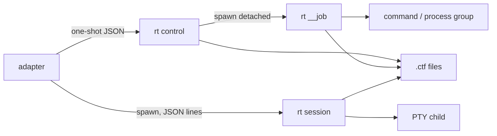

# pi4ctf Rust 内核设计

> 状态：**详细参考** —— Rust 内核的目标实现设计；**Rust `bin/rt` 尚未实现**，当前可运行版本是 TS 内核（行为以 [`design.md`](design.md) 为准）。
>
> **定位：内核，不是完整插件。** 本文只定义 `rt` 内核：进程、文件、证据、状态与扩展缝。
> 这不是 pi 插件设计，也不是工具接入/环境扩展方案；上层 pi 集成、题型工具、MCP、浏览器/逆向环境不在本文范围内，后续通过协议与扩展缝接入。
>
> **状态：详细参考。** 当前施工顺序以 [`design.md`](design.md) 为准：先 TS kernel + fixtures，行为冻结后移植 Rust。本文与 `design.md` 冲突时，以 `design.md` 为准。
>
> **One binary. One state machine. Three extension seams.**
>
> 内核不做推理，不做规划，不调用 LLM；它只保证三件事：**执行有界、证据可追溯、状态可恢复**。
> Memory 只存 verified lesson（见 [`memory-design.md`](memory-design.md)）；不做 embedding、后台 LLM 抽取或 server。

---

## 0. 定位

`rt` 是一个短命 CLI，加一个可选的 PTY 会话进程。它不是 daemon、不是 server、不是框架。

| 内核做 | 内核不做 |
|---|---|
| `exec` / PTY / 输出整形 / artifact | LLM 调用、RAG、prompt、规划 |
| typed Fact、Intent 队列、Hint、flag 账本 | 多 agent 调度、claim/lease、DAG 调度 |
| 命令 job、超时、进程组、结果投递 | 常驻任务队列、数据库、消息总线 |
| 路径/凭据限制、环境探测、doctor | 通用沙箱、内核级网络阻断（v1 不做） |
| capability 注册与分发 | 动态插件加载、插件市场、自动安装 |
| `.ctf/` 状态与可重建投影 | UI、TUI、Web 控制台 |

内核的消费者只有三类：

1. `extensions/ctf.ts`：把 pi 的 3 个工具映射到内核协议。
2. 测试与 fixture：直接调用库或 CLI。
3. 未来的适配器：只要说 JSON 协议，不依赖 pi。

---

## 1. 进程模型：没有 daemon



三种进程，三种生命周期：

| 形态 | 生命周期 | 谁持有 | 用途 |
|---|---|---|---|
| `rt <op>` | 一次请求、一次响应、退出 | adapter 同步调用 | case/fact/intent/flag/graph/doctor |
| `rt session` | 长会话，stdin EOF 即退出 | adapter 持有 | gdb/nc/python REPL |
| `rt __job <jobId>` | 单个命令的生命周期，退出 | 无（detached） | async command job |

没有 socket、没有监听端口、没有全局后台服务。`__job` 是一次性 supervisor，不是 daemon；一个 job 一个进程，结束即退出。

### 1.1 为什么 async 不是 daemon

`run({async:true})` 需要跨父轮存活，但 v1 不引入常驻任务服务：

1. 控制进程写 `jobs/<jobId>/manifest.json`。
2. 派生 `rt __job <project> <jobId>`，stdin/stdout 重定向到文件，进程脱离父进程组。
3. 控制进程立即返回 `jobId`。
4. supervisor 执行命令、写状态、写 artifact、写 `result.json`，退出。
5. adapter 用 `job.inspect/wait/ack` 读取结果；`complete` 只接受已 ack 的结果。

崩溃语义：supervisor 崩溃时 job 进入 `orphaned`，不自动重跑；adapter 只能 inspect 或显式 cancel/clean。父进程崩溃不影响已 detached 的 supervisor。

---

## 2. 磁盘状态

容器目录 `<container>/.ctf/`；每个 case 一个时间戳目录，挑战文件根可位于容器内：

```text
test/
  .ctf/index.json                 {"version":1,"active":"20261031-1420"}
  .ctf/20261031-1420/
    project.json                  root=challengeRoot, caseId, counters
    facts/f0001.json
    intents/i0001.json
    hints/h0001.json
    events.jsonl
    flags.jsonl
    artifacts/
    jobs/<jobId>/{manifest,state,stdout,stderr,result}.json|log
    sessions/<sessionId>.json
    traces/
    scratch/
    graph.json
    graph.md
    state.json
    progress.md
    chal.json
    .lock
  workspace/20261031-1420/        per-case writable workspace
  challenges/A/
  challenges/B/
```

旧版 `<challenge>/.ctf/project.json` 仍按单 case 读取；新写入使用容器布局。`project.root` 是 challenge files root，`project.containerRoot` 与 `project.caseId` 记录归属；Docker 只挂载 challenge root 和该 case 的 workspace。

原则：

- **一文件一节点**：Fact、Intent、Hint、job 都是独立文件；不做单一大 JSON。
- **原子替换**：写同目录临时文件 → `fsync` → `rename`。
- **短锁**：`.ctf/.lock` 的 `flock` 只保护计数、追加事件、队列迁移、flag 账本；不跨命令持有。
- **投影可删**：`graph.json`、`graph.md`、`state.json` 是投影，可由事件与节点重建。
- **ID 确定**：`f0001`、`i0001`、`h0001`、`cmd-0007`、`job-0003`；项目内单调，不用 UUID。
- **时间戳**：epoch 毫秒；内核不格式化日期，adapter 负责展示。
- **路径相对**：artifact 路径相对 `.ctf/`，例如 `artifacts/cmd-0007.log`；不写绝对路径。
- **项目身份**：`project.json` 保存 root canonical path 与 `file-id`（dev:ino / Windows file ID）；根被替换或移动时 fail closed。

### 2.1 `project.json`

```json
{
  "version": 1,
  "id": "csaw2018-crypto-babycrypto",
  "title": "babycrypto",
  "goal": "拿到 flag 并验证",
  "origin": "题目目录 + ciphertext.txt",
  "status": "active",
  "category": "crypto",
  "backend": "wsl2",
  "root": "C:/ctf/babycrypto",
  "rootIdentity": "…",
  "envHash": "…",
  "flagFormat": "flag\\{[^}]+\\}",
  "oracle": { "type": "local", "ref": "../oracle.json" },
  "deadline": 1760000000000,
  "counters": { "fact": 7, "intent": 4, "hint": 2, "command": 12, "job": 3 },
  "revisions": { "event": 42, "fact": 7, "intent": 4, "hint": 2 }
}
```

`backend` 只接受 `host | wsl2`；`docker` 在 v1 返回 `UNSUPPORTED`。`oracle` v1 只接受 `local`；CTFd 适配器后置。

### 2.2 `events.jsonl`

```json
{"seq":42,"ts":1760000000000,"type":"fact.add","revision":7,"actor":"explore","payload":{"id":"f0007","commandId":"cmd-0012"}}
```

事件只追加，不改写。`type` 是稳定字符串；`payload` 不内联长输出，只放引用。`revision` 对应 `project.json.revisions`。

### 2.3 `graph.json` / `state.json`

- `graph.json`：Fact→Intent 引用边、flag 来源、验证状态；**只用于审计/恢复**，不参与调度。
- `state.json`：队列头、活跃 Intent、活跃 job、计数、revision；可重建。
- `graph.md`：人读审计摘要。
- 投影写入失败不回滚事件；`state.rebuild` 从事件与节点重建。

---

## 3. 状态模型

### 3.1 Fact

```json
{
  "id": "f0003",
  "kind": "service",
  "description": "10.0.2.15:80 nginx 1.24，存在 /admin 登录页",
  "data": { "host": "10.0.2.15", "port": "80", "product": "nginx/1.24" },
  "source": { "commandId": "cmd-0012", "artifact": "artifacts/cmd-0012.log", "sha256": "…" },
  "verified": true,
  "verifier": "exit-zero+artifact",
  "intentId": "i0004",
  "createdAt": 1760000000000
}
```

不变量：

- `source.commandId` 必须存在于 `events.jsonl`；`artifact` 必须存在且 hash 匹配。
- `verified` 只能由 `fact.verify` 置 true；`fact.add` 永远写 false。
- `description` ≤ 2 KB；长内容只引用 artifact。
- `kind`：`host|service|cred|vuln|loot|flag|general`。
- Fact 只增不改；新结论写新 Fact。

### 3.2 Intent

```json
{
  "id": "i0004",
  "order": 4,
  "from": ["f0001", "f0003"],
  "description": "验证 /admin 是否存在 SQLi；优先 boolean blind",
  "state": "pending",
  "createdAt": 1760000000000,
  "startedAt": null,
  "concludedAt": null
}
```

- `order` 由 store 单调分配；队列头是 `order` 最小的 `pending`。
- `from` 是证据引用，不是 ready 门禁；`goal` 不能作为来源。
- 状态机：`pending → active → done | rejected`；同一时刻最多一个 `active`；拒绝跨级与回退。
- 终态不可改；失败写 `rejected`，不产生 Fact。
- 不引入 `worker`、`claim`、`lease`、`confirm`；v1 单写者。
- 恢复：`intent.reopen` 允许 `active → pending`，必须写 audit 事件与原因；仅用于进程崩溃后的显式恢复。

### 3.3 Flag 账本

`flags.jsonl` 一行一条：

```json
{"flag":"flag{...}","source":{"kind":"run","ref":"cmd-0019"},"status":"candidate","layers":{"format":true,"provenance":true,"oracle":false,"dedupe":true},"oracle":"local","ts":1760000000000}
```

状态：`candidate → recorded → accepted | rejected`；`submitted` 只在外部适配器显式提交时出现。

四层：

1. 格式：`flagFormat` + 占位符排除。
2. 溯源：在真实命令 artifact 或工作区文件中出现。
3. oracle：v1 只支持本地 ground truth；CTFd/人工是后置适配器。
4. 去重与 decoy：账本 + 来源上下文。

只有四层全过才 `accepted`，才允许原子写 `flag.txt`；`flag` 是唯一写入口。

### 3.4 全局不变量

- 一个项目最多一个 `active` Intent；最多 5 个 `pending`。
- `complete` 只接受 `verified=true` 的 Fact；至少一个来源；`goal` 不是来源。
- `complete` 时没有活跃 command job；所有终态结果已 `ack`。
- `flag.accept` 必须四层全过；模型口述不是来源。
- `graph.json`、`state.json` 永远不是事实来源。

---

## 4. 协议

### 4.1 请求/响应

控制面：stdin 读一个 JSON 对象，stdout 写一个 JSON 对象，退出。stderr 只放日志。

```json
{
  "version": 1,
  "op": "fact.add",
  "requestId": "req-01",
  "project": "C:/ctf/babycrypto",
  "input": {},
  "limits": {}
}
```

```json
{
  "version": 1,
  "requestId": "req-01",
  "ok": true,
  "data": {},
  "warnings": [],
  "revisions": { "event": 43, "fact": 8 }
}
```

规则：

- 未知字段拒绝；`version` 不匹配返回 `UNSUPPORTED_VERSION`。
- `requestId` 原样回显；缺省由内核生成。
- stdout 只有一行 JSON；诊断信息走 stderr。
- 所有路径相对项目根；绝对路径只在 `doctor`/`env` 输出。

### 4.2 操作表

| op | 说明 |
|---|---|
| `project.init` | 旧版单 case：创建 `<challenge>/.ctf/project.json`，绑定 root、goal、backend、target、oracle、flagFormat；只 pin 含 flag/flagSha256 的 oracle |
| `case.init` | 在 container 下创建 `.ctf/<caseId>/`、`workspace/<caseId>/`，写 challengeRoot，更新 `.ctf/index.json` |
| `case.activate` | 按 `caseId` 或包含目录选择 case，更新 `.ctf/index.json` |
| `project.status` | 有界摘要、caseId/root/workspace、队列头、活跃 job、deadline、revisions |
| `project.close` | completed/failed/stopped，写 close 事件 |
| `fact.add` | 追加未验证 Fact；校验 commandId/artifact/hash |
| `fact.verify` | 运行验证；通过则写新 Fact 或更新 verified 状态 |
| `intent.add` | 追加 Intent；分配 order；去重 |
| `intent.next` | 读队列头，不改变状态 |
| `intent.start` | `pending → active`；已有 active 则冲突 |
| `intent.conclude` | `active → done|rejected` |
| `intent.reopen` | `active → pending`，需原因与 audit |
| `hint.add` | 追加 Hint |
| `case.checkpoint` | 写状态快照与目标 |
| `case.restart` | 人类触发：可选 caseId，激活并重开 case，清预算/时间限制/soft negatives；无次数上限 |
| `case.handoff` | 生成 `progress.md` |
| `case.preflight` | 扫描 ELF/libc + 非 ELF 格式，写 `.ctf/<caseId>/chal.json`（静态元数据，不占执行预算） |
| `case.configure` | 修 flagFormat/oracle/backend/target，校验 target 可达与 oracle 绑定 |
| `case.doctor` | 后端/host 工具 digest/健康检查 |
| `case.evidence` | 读 artifact；支持 grep/head/tail；probe batch 可汇总 children |
| `proc` | 按 live session 读 `/proc` maps/libs/mem（observation，不占执行预算） |
| `case.memory.*` | `add/cue/capture/search/get/list/invalidate/stats`；verified lesson、project/global scope、cue/fire ledger、redaction、注入文本 |
| `case.complete` | verified Fact 门禁；写 completed |
| `run.exec` | 同步命令；支持 target/env；返回 summary/artifact/hash |
| `run.async` | 写 manifest、派生 supervisor、返回 jobId |
| `job.inspect` | 非阻塞快照 |
| `job.wait` | 有界等待；超时只返回快照 |
| `job.ack` | 标记结果已投递；`complete` 门禁依赖 |
| `job.cancel` | 协作式取消；终止进程组 |
| `job.clean` | 清理已 ack 的终态 job |
| `flag.add` | 候选 flag；跑四层 |
| `flag.verify` | 只跑 oracle/溯源，不写 flag.txt |
| `flag.accept` | 四层全过才写 ledgers + flag.txt |
| `graph.render` | 重建 `graph.json`/`graph.md` |
| `state.rebuild` | 从事件与节点重建投影 |
| `doctor` | 环境、锁、版本、孤儿 job、临时文件 |
| `env.snapshot` | 后端、工具版本、arch、libc、hash |
| `cap.list` / `cap.describe` / `cap.run` | capability 扩展缝 |

### 4.3 错误

| code | 退出码 | 含义 |
|---|---|---|
| `OK` | 0 | 成功 |
| `INVALID_REQUEST` | 2 | JSON/schema/字段错误 |
| `NOT_FOUND` | 3 | 项目/Fact/Intent/job/artifact 不存在 |
| `CONFLICT` | 4 | 状态迁移冲突、已有 active Intent |
| `LIMIT` | 5 | 2MB/128KB/64MB/并发/队列上限 |
| `TIMEOUT` | 6 | 控制面或命令超时 |
| `UNSUPPORTED` | 7 | 平台/后端/capability 未启用 |
| `SECURITY` | 8 | 路径越界、symlink、凭据、设备名 |
| `ORACLE` | 9 | oracle 失败或拒绝 |
| `FLAG_REJECTED` | 10 | 四层未过 |
| `JOB_LOST` | 11 | supervisor 崩溃/孤儿 |
| `INTERNAL` | 12 | 不变量或 IO 错误 |
| `TARGET_UNREACHABLE` | 13 | target 声明后 TCP 不可达（未执行，不计预算） |

错误响应带 `error.code`、`error.message`、`error.details`；不返回堆栈。

---

## 5. 执行引擎

### 5.1 输入形态

`run.exec` 三者互斥：

```json
{ "argv": ["python3", "solve.py"] }
{ "command": "cat ciphertext.txt | xxd | head", "shell": "bash" }
{ "scriptPath": "scripts/solve.py", "argv": ["python3"] }
```

- `argv`：不经过 shell，参数边界明确；推荐。
- `command`：固定 shell；WSL2/Linux 用 `bash -lc`，host Windows 用 `powershell -NoProfile -NonInteractive -Command`；响应里记录 `shell`。
- `scriptPath`：必须是工作区内普通文件；拒绝 symlink/junction/设备名；解释器由 `argv` 指定。

不做隐式 shell、不做字符串拼接、不做登录 shell 的环境继承。

### 5.2 预算

| 项 | 默认 | 上限 |
|---|---|---|
| 控制面请求 | 30 s | 30 s |
| 命令执行 | 120 s | 600 s |
| stdout/stderr 合计 | 128 KiB 传输 | 64 MiB artifact |
| summary | 16 KiB | 16 KiB |
| 并发调用 | 2 | 2 |
| 等待调用 | 8 | 8 |
| 环境变量 | allowlist | 64 个键 |
| stdin | 1 MiB | 1 MiB |

控制面 30 s 与命令 120 s 分开：查状态、读 artifact 不应占用命令预算；长命令走 async 或 PTY。

### 5.3 进程与超时

- 每个命令一个进程组/Job Object；超时先 SIGTERM/Terminate，宽限 2 s，再 SIGKILL/TerminateJobObject。
- stdout/stderr 并发读取，避免管道死锁。
- 捕获 `exit`、`signal`、`durationMs`；shell 模式记录 `shell`。
- 命令结束写 `events.jsonl`，包含命令签名、cwd、backend、exit、artifact hash。
- 失败不自动重试；unknown effects 只做后置条件校验。

### 5.4 输出整形

确定性规则，不调用模型：

- 去 ANSI/OSC、统一 CRLF、UTF-8 lossy。
- 折叠连续重复行（最多保留 3 行）。
- 保留错误、异常、命中、路径、数字、flag 行。
- 大输出：head 3 MiB + rolling tail 1 MiB；中间标记 `[TRUNCATED]`。
- 二进制：`mode=auto` 检测 NUL/非 UTF-8，转 hex 摘要；`raw` 原样落 artifact；`hex` 强制。
- summary 只来自整形后的文本；artifact 保存完整（最多 64 MiB）。

### 5.5 artifact 与 results

- `artifacts/cmd-0007.log`：完整输出。
- `artifacts/cmd-0007.meta.json`：bytes、lines、sha256、truncated、encoding、exit。
- `results`：结构化结果的临时存储；`result.put/page/release` 供 `session py` 使用；绑定 project、root identity、TTL 24h。
- 分页 1–512 行、512–65536 字节；跨项目/跨根/过期拒绝。

---

## 6. PTY 会话

`rt session` 是长会话进程，stdin/stdout 用 JSON Lines，不污染 PTY 数据。

```json
{"op":"open","id":"s1","argv":["bash"],"cwd":".","cols":120,"rows":40,"backend":"wsl2"}
{"op":"write","id":"s1","data":"ls\r","enc":"utf8"}
{"op":"read","id":"s1","timeoutMs":1000,"maxBytes":65536}
{"op":"resize","id":"s1","cols":100,"rows":30}
{"op":"close","id":"s1"}
```

响应：

```json
{"ok":true,"id":"s1","seq":12,"data":"...","enc":"utf8","exited":false,"artifact":"artifacts/session-s1.log"}
```

规则：

- `read` 只返回上次 `seq` 之后的增量；完整缓冲写 artifact。
- `data` 默认 utf8；非 UTF-8 使用 `enc:"base64"`。
- 最多 4 个 session（adapter 强制；内核写 `sessions/<id>.json` 供 doctor 检查）。
- stdin EOF 时 session 终止进程组并退出，避免孤儿。
- `preset:"py"`：设置 `PYTHONPATH` 与 `CTF_PROJECT`，启动 `python3 -u`；SDK 通过 `rt cap` 调用内核，不另开服务。

---

## 7. Async command job

### 7.1 状态机

```text
queued → preparing → running → completed
                         ├── failed
                         ├── cancelled
                         ├── timed_out
                         └── orphaned
```

终态不可变；`orphaned` 只由 doctor/启动扫描写入。

### 7.2 文件

```text
jobs/job-0003/
  manifest.json   # argv/command, cwd, env, limits, backend, createdAt
  state.json      # state, pid, pgid, startedAt, endedAt, lastActivityAt, error
  stdout.log
  stderr.log
  result.json     # exit, signals, artifact, hash, summary, resultRevision
  cancel          # 可选取消标记
  delivered.json  # adapter ack 后写入
```

### 7.3 投递

- supervisor 完成时写 `result.json`，`resultRevision` 单调增加。
- `job.inspect` 返回 `delivered: false`；adapter 把结果注入 prompt 后调用 `job.ack`。
- `complete` 门禁：没有活跃 job；所有终态 job `delivered`。
- 结果晚到不污染当前 prompt；`job.ack` 只接受精确 revision。
- 重启扫描：`running` 但 pid 不存在 → `orphaned`；不自动重跑。

### 7.4 取消

- 写 `cancel` 标记 + 向进程组发 SIGTERM/GenerateConsoleCtrlEvent。
- 宽限 2 s，然后 SIGKILL/TerminateJobObject。
- supervisor 负责把终态写回；若 supervisor 已死，doctor 标 `orphaned`。

---

## 8. Flag 与 oracle

```rust
trait Oracle {
    fn verify(&self, flag: &str, ctx: &OracleContext) -> Result<OracleVerdict, KernelError>;
}
```

v1 只注册 `LocalOracle`：

- `oracle.json` 位于工作区外；包含 flag hash 或精确值；不接受模型写入。
- `flag.verify` 只做验证；`flag.accept` 才写账本与 `flag.txt`。
- CTFd/人工 oracle 是后置适配器；即使接入，也必须由显式用户命令触发，模型工具不能直接提交。

flag 四层由 `verify.rs` 实现，账本由 `flag.rs` 实现；任何一层失败都写 `rejected` 事件，不写 `flag.txt`。

---

## 9. 扩展缝

只保留三个 trait/边界；不为未来预建框架。

### 9.1 Backend

```rust
trait Backend {
    fn probe(&self) -> Result<EnvInfo, KernelError>;
    fn prepare(&self, spec: &ExecSpec) -> Result<PreparedExec, KernelError>;
    fn prepare_session(&self, spec: &SessionSpec) -> Result<PreparedSession, KernelError>;
}
```

v1：

- `HostBackend`：Windows 本机；路径原样；PowerShell 可显式选择。
- `Wsl2Backend`：`wsl.exe -d <distro> --cd <mapped> -- <argv>`；Windows 路径用 `wslpath -a` 映射；`doctor` 检查 distro 与工具。
- `DockerBackend`：v1 返回 `UNSUPPORTED`；M8 后再实现。

后端只负责“怎么启动”和“路径怎么映射”，不解析 CTF 内容。

### 9.2 Capability

```rust
trait Capability {
    fn name(&self) -> &'static str;
    fn version(&self) -> u32;
    fn input_schema(&self) -> &'static str;
    fn run(&self, ctx: &CapContext, input: &Value) -> Result<Value, KernelError>;
}
```

- 静态注册，不动态加载 `.so`/`.dll`/WASM；新增能力 = 新模块 + 注册 + fixture + 版本。
- `cap.list` / `cap.describe` / `cap.run`；输入输出都是 JSON，未知字段拒绝。
- 能力默认无网络、无状态写入；需要 artifact/结果引用必须走内核 API。
- v1 内置：`artifact.read`、`result.page`、`result.release`、`env.snapshot`。
- 后置：`inspect.elf`、`traffic.pcap`、`web.http`、`disasm.objdump`；每个都要 fixture + 差分/回归 + 15 题 A/B。
- 能力不新增顶层 pi 工具；通过 `run` 的 `capability` 字段或 `session py` SDK 调用。

### 9.3 Oracle

见 §8。v1 只有 `LocalOracle`；CTFd/人工后置。

### 9.4 工具接入与环境扩展

- 外部工具（gdb、nmap、tshark、Ghidra MCP、浏览器）先通过 `run`/`session` 接入；只有出现重复、可验证的结构化需求，才固化为 capability。
- MCP/浏览器/逆向留在 pi 适配层或外部进程；内核不内嵌 MCP client，不做浏览器控制。
- 环境扩展只通过 `Backend` + `doctor` + `env.snapshot`；不硬编码发行版路径。
- 不在内核里写题型分支；题型决策属于 skill/prompt。

---

## 10. Rust 结构

```text
crates/
  kernel/          # 业务与协议；#![forbid(unsafe_code)]
    src/lib.rs
    src/protocol.rs
    src/error.rs
    src/project.rs
    src/state/{mod,facts,intents,hints,events,projection}.rs
    src/exec/{mod,process,shape,artifact,limits}.rs
    src/session/{mod,pty,protocol,sdk}.rs
    src/jobs/{mod,supervisor,state,result}.rs
    src/flag/{mod,ledger,oracle}.rs
    src/memory/{mod,store,search,cue,ledger,redact,inject}.rs
    src/capability/{mod,registry,builtin/*}.rs
    src/backend/{mod,host,wsl2}.rs
    src/doctor.rs
  rt-sys/          # setsid/killpg/LockFileEx/JobObject；允许 unsafe
  rt/              # 薄 bin：参数解析、stdin/stdout、退出码
```

`kernel` 不依赖 pi；`rt` 不认识 CTF 题型。一个 workspace 仍只产出一个 `rt` 二进制。

### 10.1 依赖

| crate | 用途 | 约束 |
|---|---|---|
| `serde` / `serde_json` | 协议、状态 | 不开 `preserve_order` 以外的特性 |
| `blake3` | artifact hash | 比 SHA-256 快；可替换 |
| `fs2` | 跨平台文件锁 | Windows `LockFileEx` |
| `portable-pty` | ConPTY/Unix PTY | 不引 `node-pty`/node-gyp |
| `command-group` | 进程组/Job Object | 超时杀树 |
| `file-id` | root identity | 跨平台 file ID |
| `regex-lite` | flagFormat | 不用完整 `regex`，控制体积 |
| `lexopt` | CLI 参数 | 不用 `clap` |
| `base64` | session 二进制 | 仅 PTY 协议 |
| `windows-sys` / `libc` | 平台调用 | 只在 `rt-sys` |

不用：`tokio`、`rmcp`、`anyhow`、`chrono`、`uuid`、`tempfile`、动态插件框架。

### 10.2 构建与性能

- `lto="fat"`、`codegen-units=1`、`panic="abort"`、`strip=true`。
- 目标：二进制 <5 MB；冷启动 <20 ms；4 sessions RSS <32 MB；10 MB 整形 <100 ms；PTY 往返 <5 ms；Fact 写入 <5 ms。
- CI 在 Windows x64 与 Linux x64 跑性能门禁；macOS 只构建，不验收。

---

## 11. 安全边界

- **路径**：root canonicalize + `file-id`；逐段 no-follow；拒绝 `..`、symlink、junction/reparse point、Windows 设备名；写操作只允许工作区与会话私有临时目录。
- **凭据**：默认拒绝 `~/.ssh`、`~/.aws`、`~/.config/gh`、浏览器配置等；glob/grep 也跳过；项目显式开启才放行，并写 audit。
- **环境变量**：allowlist；不继承模型密钥；`env` 输入只接受白名单键。
- **命令**：`argv` 不经过 shell；`command` 显式选择 shell；`scriptPath` 不拼接字符串。
- **网络**：v1 **不做内核级阻断**。`network:"deny"` 在 host/WSL2 返回 `UNSUPPORTED`；`networkVerdict` 只记录声明与实际观测。强阻断依赖 Docker/网络沙箱，后置。
- **flag**：模型不能自证；`flag.txt` 唯一写入口；tool hook 阻止直接写。
- **prompt injection**：内核不解释文本；capability 不得执行输入中的指令；网页/题目输出只作为数据。

> 这是 v1 的诚实边界：路径与凭据可以硬约束；网络强隔离不在 v1 内核内，不能用“白名单”假装。

---

## 12. 崩溃与恢复

| 场景 | 行为 |
|---|---|
| 写节点前崩溃 | 临时文件残留；下次 `doctor` 清理，不影响正式文件 |
| rename 前崩溃 | 旧文件仍完整；事件未追加，操作视为未发生 |
| 事件追加后崩溃 | 节点是源；`state.rebuild` 重建投影 |
| 投影写失败 | 不回滚事件；`graph.render` 重建 |
| supervisor 崩溃 | job → `orphaned`；不自动重跑；inspect/cancel/clean |
| adapter 崩溃 | session stdin EOF → 终止进程组；job 继续 detached |
| active Intent 卡住 | `intent.reopen` 显式回退，写 audit 与原因 |
| 锁竞争 | 有界重试（100ms × 10）；超时返回 `CONFLICT`，不无限等 |
| 未知写入效果 | 标记 `unknown`；只做后置条件校验，不盲目重试 |

`state.rebuild` 必须能仅凭 `project.json`、`facts/`、`intents/`、`hints/`、`events.jsonl`、`flags.jsonl` 重建 `state.json`/`graph.json`。

---

## 13. 测试与验收

### 13.1 单元

- 路径：`..`、symlink、junction、设备名、长路径、UNC、WSL2 映射。
- 锁：并发写计数、事件追加、flag accept；无丢事件。
- 队列：order、单 active、非法迁移、reopen、去重。
- flag：四层逐层失败；accepted 才写 `flag.txt`；重复/decoy。
- 整形：ANSI、CRLF、重复行、二进制、超大输出、UTF-8 边界。

### 13.2 属性测试

- 任意事件序列重放后，投影与内存状态一致。
- 任意队列操作后，`active <= 1`，终态不可变。
- 任意 flag 输入，未过四层不得出现 `flag.txt`。
- 任意路径输入，不得逃出 root。

### 13.3 集成

- 假命令：exit 0/非 0、信号、超时、管道、stdin、大输出、二进制。
- PTY：echo、resize、gdb 启动、EOF、进程组终止。
- Job：async 完成、超时、取消、supervisor kill、orphan、ack 门禁。
- 后端：host、WSL2 路径映射、`doctor` 缺工具、docker unsupported。
- 崩溃：kill -9 在写节点/投影/job 中途；重启恢复。
- 安全：凭据路径、工作区外写、symlink、环境泄漏。

### 13.4 Fuzz 与性能

- fuzz JSON 协议、未知字段、超长字段、畸形 UTF-8；不得 panic。
- CI：二进制、冷启动、RSS、10 MB 整形、PTY 往返、Fact 写入。

### 13.5 验收

| 阶段 | 门槛 |
|---|---|
| K0 | store/事件/队列/投影/doctor 全绿；重建一致 |
| K1 | exec 同步、超时、整形、artifact、限制全绿 |
| K2 | async job、cancel、orphan、ack 门禁全绿 |
| K3 | PTY open/write/read/resize/close、EOF 清理全绿 |
| K4 | flag 四层、ledger、flag.txt 全绿 |
| K5 | capability 注册/调用、host/WSL2 backend、env.snapshot 全绿 |
| K6 | 安全矩阵、fuzz、性能门禁、崩溃恢复全绿 |
| K7 | 与 pi adapter 的 3 工具端到端；15 题 A/B；CTFTiny 50 |

---

## 14. 里程碑

| 阶段 | 交付 | 验收 |
|---|---|---|
| K0 | workspace、协议、project store、Fact/Intent/Hint、事件、投影、doctor | 一文件一节点；锁；重建；队列不变量 |
| K1 | exec、进程组、超时、shape、artifact、limits | 10 MB <100 ms；进程组终止；大输出不爆内存 |
| K2 | async supervisor、job inspect/wait/ack/cancel/clean | 跨父轮存活；orphan 检测；ack 门禁 |
| K3 | PTY session、JSON Lines、增量 read、resize、close | 4 sessions；EOF 清理；artifact 完整 |
| K4 | flag ledger、LocalOracle、四层、flag.txt | 误报 0；四层失败不写 |
| K5 | capability registry、内置 artifact/result、Host/WSL2、env.snapshot | schema/fixture；WSL2 路径映射 |
| K6 | 安全矩阵、fuzz、性能、崩溃恢复 | 越界 0；无 panic；预算达标 |
| K7 | pi adapter 集成 | 3 工具端到端；15 题；CTFTiny 50 |

---

## 15. 非目标与后置

**v1 不做**：

- Docker 后端、内核级网络阻断、强沙箱。
- 多 worker、claim/lease、intent job。
- 动态插件、插件市场、自动安装。
- CTFd 自动提交、人工 oracle 的模型自助确认。
- 题型专用解析（pcap/ELF/JWT/HTTP）在核心内。
- LLM、RAG、prompt、UI。

**后置顺序**：

1. Docker backend + 网络隔离（M8）。
2. `inspect.elf`、`traffic.pcap`、`web.http`、`disasm.objdump`（每个都要 fixture + A/B）。
3. CTFd/人工 oracle 适配器（显式用户命令，不自动提交）。
4. 多 worker（若 M5 A/B 证明收益；需要重新引入 claim/lease）。

---

## 16. 一句话

内核只做三件事：**把命令跑在有界环境里，把观察变成可追溯证据，把状态做成可恢复队列。**
其余都通过 `Backend`、`Capability`、`Oracle` 三个缝接入；不够痛就不加。
